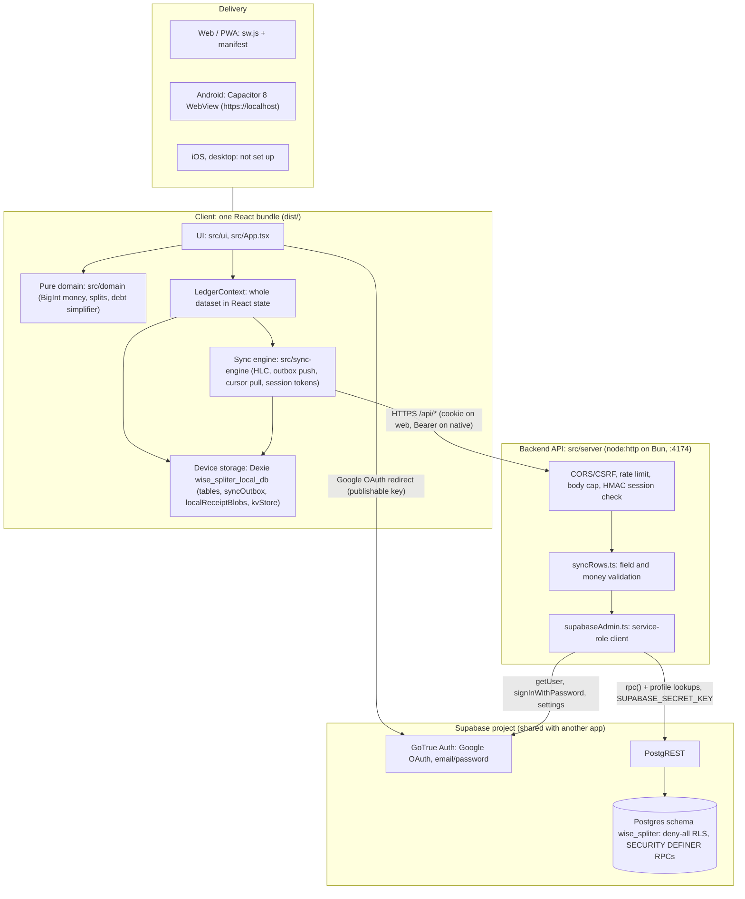

# Wise-Spliter: System Architecture

Describes the code as it is now. Details live in the linked specs:

* [Feature Requirements](./feature-requiremrnts.md)
* [Technical Spec and Financial Algorithms](./technical-spec.md)
* [Database Schema and Sync Spec](./database-and-sync-spec.md) (authoritative for the sync protocol and RPC rules)
* [Database Capacity and Free-Tier Ceilings](./database-capacity.md)
* [P2P Receipt Mesh Plan](./p2p-receipt-mesh-plan.md) (planned, not implemented)
* [Cloudflare Worker Migration](./tasks/Cloudflare-Worker.md) (planned)
* [Coding Standards](./coding-standards.md)

---

## 1. Summary

* **One client codebase:** React 19 + Vite 6 + Tailwind v4 SPA in `src/`. The same `dist/` bundle is served on the web (PWA) and wrapped by Capacitor 8 for Android. iOS and desktop shells are not set up yet (Section 3).
* **Local first:** the full ledger lives on the device (React state, with IndexedDB via Dexie 4 as the source of truth). Every change is diffed into a per-entity outbox and synced in the background.
* **Thin backend, no framework:** `src/server/index.ts` is a plain `node:http` server (a route map of 10 handlers) started with `bun run`. It authenticates the caller, validates payloads and forwards to Postgres RPCs. It holds no state besides per-process rate-limit maps.
* **Authorization lives in Postgres:** schema `wise_spliter` in a Supabase project that is shared with another app. `anon` and `authenticated` have no privileges, RLS is deny-all, and only five `SECURITY DEFINER` RPCs (callable by `service_role` only) read or write tenant data.
* **Receipts never leave the device:** only a SHA-256 pointer row is synced.

---

## 2. Topology

In local dev, Vite (`:4173`) proxies `/api` to the API (`:4174`), so the browser sees one origin.

---

## 3. Platform Matrix

| Platform | Status | Evidence | Gaps |
| --- | --- | --- | --- |
| **Web / PWA** | Working | `public/manifest.webmanifest` (standalone, 192/512/maskable icons); `public/sw.js` network-first cache `wise-spliter-offline-v4`, skips `/api/*`; registered only in production builds and never inside Capacitor (`src/main.tsx`) | Precache holds only the HTML shell and icons; hashed JS/CSS are cached on the first fetch after the worker controls the page, so offline start needs one earlier online load. Safari may evict storage of sites not added to the Home Screen after 7 days of no use, which would drop an unsynced outbox. |
| **Android** | Builds an installable APK | `android/` (Capacitor 8, compile/target SDK 36, min SDK 24), `capacitor.config.ts` (`androidScheme: 'https'`), `make apk` / `make apk-prod` via `scripts/build-apk.sh` with host SDK or `Dockerfile.android` | The script always runs `assembleDebug`, so even `apk-prod` ships a debug-signed APK with `versionCode 1`; there is no release signing or AAB for Play. Google sign-in navigates the WebView itself to the OAuth URL (`DevAuthModal.tsx`), which Google blocks in embedded WebViews; email/password works. `apk-prod` requires an `https://` public `VITE_API_BASE_URL`. |
| **iOS** | Not set up | No `ios/` folder, no `@capacitor/ios` dependency. Code is ready for it: `capacitor://localhost` is an allowed origin and `resolveApiUrl` treats `capacitor:` as native. | `bun add @capacitor/ios`, `bunx cap add ios`, a Mac with Xcode, an Apple Developer account, and the same system-browser OAuth fix as Android. |
| **Desktop** | Only as an installed PWA | No `src-tauri/`, no `@tauri-apps/*` dependency, no Electron. Only the API origin list (`tauri://localhost`, `https://tauri.localhost`) and `resolveApiUrl` mention Tauri. | Add Tauri only if a store build, file system or tray is needed. Tauri 2 on Windows defaults to `http://tauri.localhost`, which production rejects, so set `useHttpsScheme`. |

---

## 4. Client Architecture

* **UI** (`src/ui/pages`, `src/ui/modals`, `src/ui/primitives`, `src/App.tsx`): six pages, four modals, shared primitives. Rules in [coding-standards.md](./coding-standards.md) and `AGENTS.md`.
* **Domain** (`src/domain`): pure TypeScript, no I/O. BigInt minor units for 0/2/3-decimal currencies, five split modes with a frozen rotating remainder, bitmask-DP debt simplification. Algorithms in [technical-spec.md](./technical-spec.md).
* **State** (`src/state/LedgerContext.tsx`): one provider holds the whole `MockLedgerDataset`, loaded from Dexie at startup (the UI renders once it is loaded). An old full snapshot (Dexie JSON or the `localStorage` blob of earlier versions) is migrated once and removed. On every dataset change it diffs the previous and next dataset into mutations (`diffDatasetToMutations`) and calls `commitLocalChanges` (`src/storage/local-db.ts`), which writes only the changed rows plus those outbox rows in one Dexie transaction, so a kill keeps both or neither. Rows keep their order through an `_o` sort key; the non-entity fields live in one `kvStore` row. A failed write (for example a full disk) keeps the baseline and the mutations for the next commit and shows a calm toast. The outbox is coalesced to one row per `entity:id`, ordered by `seq`; a group's base-currency change is moved ahead of queued bills.
* **Signing in on a device with signed-out data:** a dialog offers "Bring my local data into this account" (non-sample groups and direct bills are pushed, with the signed-out "me" mapped to the account) or "Start fresh" (with a JSON backup download first).
* **Sync loop** (`runSyncRef` in `LedgerContext`): runs 1.5 s after a local change, on app start, on `online` and on `visibilitychange`; one run at a time, exponential backoff up to 5 min. There is no polling and no Realtime, so other members' edits arrive when the app wakes or the user writes.
* **Session handling** (`src/sync-engine/supabase-sync.ts`): `resolveApiUrl('/api/...')` keeps relative paths on the web and prefixes `VITE_API_BASE_URL` in native shells (or for an `https://` base). The browser Supabase client uses only the publishable key, only for Google OAuth.
* **Fallbacks:** if IndexedDB is unavailable the storage layer falls back to in-memory tables.

---

## 5. Sync Protocol (summary)

Full rules: [database-and-sync-spec.md, Section 4](./database-and-sync-spec.md). Contract types: `src/types/sync-contract.ts`.

* **HLC:** `<48-bit ms hex>-<16-bit counter hex>-<node>`, node = user id + per-install device id. The client never runs more than 60 s ahead; the server rejects HLCs more than 60 s in the future.
* **Push** `POST /api/ledger/push`: up to 200 mutations (`upsert`, `delete`, `restore`) and 240 KB per batch. Per mutation the result is `applied`, `stale` (stored HLC is newer or equal; returns `serverHlc`), `forbidden` or `invalid`. Only those four statuses remove a row from the outbox. Last writer by HLC wins; for expenses both versions are kept in `expense_revisions` and the bill is flagged as a conflict.
* **Batch failure:** a lock timeout, deadlock or the 2 s time budget aborts the whole batch (HTTP 503); the client halves its batch size and retries. A second concurrent push for the same account gets HTTP 429 (per-account try-lock in the database).
* **Pull** `GET /api/ledger/pull?cursor=`: rows with `server_seq > cursor` that the caller may read, at most 500 per page, soft deletes as `deleted: true`. `backfillGroupIds` / `backfillExpenseIds` name groups or direct bills the caller gained access to after the cursor; the client pages each from cursor 0 (`?groupId=` or `?expenseId=`) before advancing the main cursor. A 403 on a backfill evicts that scope locally.
* **Commit order:** every write draws `server_seq` from one sequence under `pg_advisory_xact_lock(7735001)` held until commit, so a cursor can never skip a row that commits late. This is one global write lock for the whole schema.

---

## 6. Backend Runtime and Endpoints

* **Runtime:** `node:http` `createServer` in `src/server/index.ts`, run by Bun (`bun run src/server/index.ts`). No web framework. Binds `API_HOST` (default `127.0.0.1`) and `API_PORT` (default `4174`).
* **Modules:** `index.ts` (routes, body reader, errors), `securityAndAuth.ts` (tokens, CORS/CSRF, headers, rate limits), `supabaseAdmin.ts` (service-role client, profile lookups, RPC wrappers), `syncRows.ts` (trust-boundary validation and camelCase/snake_case mapping).
* **Startup checks:** production requires `GRANT_TOKEN_SECRET` of at least 32 characters, valid numeric env values, and Supabase Auth email confirmation on (`mailer_autoconfirm = false`, re-checked every 10 min; the password and Google routes return 503 if it flips).
* **Errors:** database errors become `DbUnavailable` (503, generic message); `42501` from an RPC becomes 403.

| Method and path | Auth | Purpose |
| --- | --- | --- |
| `GET /api/health` | none | Liveness plus `schema_health` reachability |
| `POST /api/auth/demo` | none | Demo session for the seeded demo profile; 404 in production |
| `POST /api/auth/google` | Supabase access token in body | Verifies a confirmed Google OAuth session, finds or creates the profile, claims placeholders |
| `POST /api/auth/login` | email + password | GoTrue password sign-in; profile must already exist and not be Google-linked |
| `POST /api/auth/logout` | session | Bumps `token_version` (revokes all of the user's tokens) and clears the cookie |
| `POST /api/auth/session` | session | Sliding renewal: new 12 h token, same original sign-in time |
| `GET /api/ledger/pull` | session | Cursor pull, optional `groupId` or `expenseId` backfill scope |
| `POST /api/ledger/push` | session | Outbox batch push |
| `POST /api/receipts/upload` | session | Receipt pointer upsert; any `dataUrl` is dropped |
| `POST /api/account/delete` | session | `delete_account` RPC, returns 204 |

---

## 7. Auth and Session Model

* **Identity providers:** Supabase GoTrue (Google OAuth, email/password). GoTrue's `auth.users` is shared with the other app; a `wise_spliter.profiles` row is what makes someone a user of this app.
* **Session token:** our own HMAC-SHA256 token, `header.payload.signature`, payload `{ aud, sub, tv, aat, iat, exp }`, signed with `GRANT_TOKEN_SECRET`. 12 h TTL; renewable until `SESSION_MAX_LIFETIME_DAYS` (default 30) after the original sign-in (`aat`). `aud` binds a token to its environment. Raw Supabase JWTs are never accepted on data routes.
* **Per-request check:** signature and claims, then a profile read; a deleted profile or a changed `token_version` rejects the token. Demo tokens are rejected in production.
* **Transport:**
  * Web: `__Host-ws_session` cookie (`HttpOnly; Secure; Path=/; SameSite=Lax`). The bearer token is kept in memory only and re-minted from the cookie through `/api/auth/session` after a reload. This needs the web app and the API on the same origin, because client fetches use `credentials: 'same-origin'`.
  * Native: `Authorization: Bearer`; the token is persisted in the Dexie `kvStore` (plain IndexedDB, not Keystore/Keychain).
* **Browser protections:** `ALLOWED_ORIGINS` allowlist plus native shell origins; in production only `https://` origins are kept. State-changing requests with a disallowed `Origin`, or with `Sec-Fetch-Site: cross-site` and no `Origin`, get 403. Strict security headers (CSP `default-src 'none'`, `nosniff`, HSTS in production).
* **Rate limits:** fixed windows, default 120 requests/min per user (or per IP, IPv6 per /64, before sign-in) and 10 failed logins per (account, IP) per 15 min. Client IP source is set by `TRUST_PROXY`. Maps are bounded but per process.
* **Placeholder claiming:** after a verified sign-in, `claim_members` binds unclaimed members and direct-split participants whose `invited_email` equals the verified email.

---

## 8. Database Security Model

Source of truth: [`0004_tenant_isolation_and_sync.sql`](../supabase/migrations/0004_tenant_isolation_and_sync.sql) and [database-and-sync-spec.md, Section 5](./database-and-sync-spec.md).

* **Isolation:** all objects live in schema `wise_spliter`. `PUBLIC`, `anon` and `authenticated` have no schema usage and no table, sequence or function privileges, including default privileges. The publishable key in the client bundle therefore cannot read or write ledger data.
* **Deny-all RLS:** RLS is enabled and forced on all 10 tables (`profiles`, `groups`, `group_members`, `expenses`, `expense_revisions`, `settlements`, `group_activity_log`, `receipt_attachments`, `expense_participants`, `quota_usage`) with no policies. The earlier membership policies were dropped in 0004.
* **RPCs:** `push_mutations`, `pull_changes`, `claim_members`, `delete_account`, `schema_health`; all `SECURITY DEFINER` with `SET search_path = ''`, `EXECUTE` granted to `service_role` only. Each starts with `assert_backend()`, which checks the `role` setting (inside a definer function `current_user` is always the owner).
* **Tenant rules in SQL:** the API passes the verified actor id; membership, roles (admin vs member), direct-split participation and server-owned fields (`created_by`, `owner_id`, actor ids and names) are decided inside the RPC transaction with indexed predicates. There is no cross-tenant filtering in JavaScript.
* **Triggers for every writer, service role included:** immutable columns, payer/split membership checks, per-tenant row caps (for example 50,000 expenses per owner and scope, 50 receipts per expense), and `server_seq` assignment under the commit-order lock.
* **Service-role direct table access:** outside the RPCs the API touches only `profiles` (lookup, bind, create, `token_version` bump).
* **Migrations:** `scripts/apply-migration.mjs` applies pending files plus a final privilege lockdown in one `psql` transaction, records them in `wise_spliter.schema_migrations`, and never uses `supabase db push` or the shared `supabase_migrations` history. `make migrate-verify` checks tables, forced RLS, RPCs and grants.

---

## 9. Receipts

* The image is compressed to WebP and stored only in Dexie `localReceiptBlobs` on the author's device, tagged with the signed-in user. Blobs survive sign-out and show again when the same user signs back in; account deletion removes them.
* What syncs is a `receipt_pointer` row (`id`, `expenseId`, `fileName`, `mimeType`, size, `sha256`) through the push endpoint or `POST /api/receipts/upload`; both drop `dataUrl`. Supabase Storage is not used and its old policy was dropped.
* Other members' devices see the pointer, not the image. Sharing images peer to peer is designed in [p2p-receipt-mesh-plan.md](./p2p-receipt-mesh-plan.md) but not built (no `/api/p2p/*` route exists). Until then, a lost device loses its receipt images.

---

## 10. Deployment Targets

| Target | How | Notes |
| --- | --- | --- |
| **Local** | `make dev`: ensures the shared local Supabase in `$SUPABASE_DIR`, applies migrations, seeds dev users (`scripts/setup-dev-user.mjs`, loopback only), then `scripts/dev-stack.mjs` runs the API (`:4174`) and Vite (`:4173`, `/api` proxy) | `make dev-ui` skips the Supabase and migration steps |
| **Docker** | `make docker-up` / `make docker-up-dev`: `docker-compose.yml` runs a Supabase preflight, `api` and `app` (`vite preview`) from `Dockerfile` | Compose does not set `API_HOST`, so the API binds `127.0.0.1` inside its container and the published port and the `app` proxy cannot reach it. The `app` service inherits a healthcheck that probes the API port. `vite preview` is not meant as a production web server. |
| **Pyrite** | `make deploy-pyrite`: builds `Dockerfile.api` (Bun, `API_HOST=0.0.0.0`, API only) for `linux/amd64` and pushes it | Default tag is `ttl.sh/...:24h` and expires; set `IMAGE_REF` to a durable registry. Run with `NODE_ENV=production` and `TRUST_PROXY=true`. The web bundle is not part of this image. |
| **Cloudflare (planned)** | API as a Worker, web bundle served from the same origin | See [tasks/Cloudflare-Worker.md](./tasks/Cloudflare-Worker.md). The handler must move from `node:http` to a `fetch(Request)` handler and the per-process rate limiter needs a shared store. Free-plan limits are in [database-capacity.md, Section 4](./database-capacity.md). |
| **Android APK** | `make apk` (dev URL) / `make apk-prod` (`.env.production`, https only) | Output `releases/wise-spliter.apk` (debug-signed) |

---

## 11. Configuration

Template: [`.env.example`](../.env.example). Copy to `.env.development` / `.env.production` (both gitignored). Only `VITE_*` values reach the client bundle and are public.

| Variable | Side | Purpose |
| --- | --- | --- |
| `SUPABASE_URL`, `SUPABASE_SECRET_KEY`, `SUPABASE_SCHEMA` | server | Service-role access to `wise_spliter` |
| `GRANT_TOKEN_SECRET` | server | HMAC key for session tokens; unique per environment, 32+ chars in production |
| `ALLOWED_ORIGINS`, `DISABLE_NATIVE_ORIGINS` | server | CORS/CSRF allowlist |
| `TRUST_PROXY` | server | Client IP source: `false`, `true` (rightmost `X-Forwarded-For`), `cloudflare` |
| `API_HOST`, `API_PORT`, `MAX_JSON_BODY_BYTES` | server | Bind address and body cap (256 KB) |
| `RATE_LIMIT_*`, `API_RATE_LIMIT`, `AUTH_RATE_LIMIT_*` | server | Limiter tuning; malformed values stop startup |
| `SESSION_MAX_LIFETIME_DAYS`, `SESSION_AUDIENCE` | server | Absolute session lifetime, token audience |
| `NODE_ENV` | server | `production` turns on secret, HTTPS-origin, demo and email-confirmation rules |
| `VITE_SUPABASE_URL`, `VITE_SUPABASE_PUBLISHABLE_KEY` | client | Google OAuth only |
| `VITE_API_BASE_URL` | client + Vite | Proxy target in dev; absolute API base for native builds |
| `SUPABASE_DIR`, `SUPABASE_DB_*`, `SUPABASE_DB_URL`, `DEV_USER_PASSWORD` | tooling | Local stack, migrations, dev seed and tests |

---

## 12. Testing Strategy and Gates

All five gates must exit 0: `make typecheck && make migrate-verify && make test && make build && make e2e`.

| Gate | What it covers |
| --- | --- |
| `make typecheck` | `tsc --noEmit` (strict) plus `scripts/check-deprecations.mjs` (no deprecated symbols) |
| `make migrate-verify` | Live checks of the local schema: tables, forced RLS, RPCs, privileges |
| `make test` | Vitest in `tests/unit/`: pure domain and portability, `fast-check` property tests, `sync-client.test.ts` (outbox, merge, backfill, HLC with `fake-indexeddb`), and two live suites (`security-breach.test.ts`, `redteam-regression.test.ts`) that drive `handleApiRequest` in process against the local Supabase |
| `make build` | `tsc -b && vite build` |
| `make e2e` | Playwright, one desktop Chromium project, `tests/e2e/`, boots `scripts/dev-stack.mjs` |

`make verify-agents` lints `AGENTS.md`, `docs/coding-standards.md` and the persona files (size budget, no en or em dashes). Builder and verifier roles are split by `agents/ORCHESTRATOR.md`.

Not covered: no CI configuration in the repo (gates run by hand), no mobile viewport or Android device tests, the live suites need a running local Supabase with specific env vars, and nothing tests multi-replica behaviour.

---

## 13. Known Limits and Next Steps

1. **Global write lock:** one advisory lock serializes all writes in the schema (a few hundred write transactions per second). Upgrade path: per-group sequences and cursors, or snapshot fencing.
2. **Shared free-tier Supabase project:** database size, egress, MAU and the 1-week inactivity pause are shared with another app; database size binds first ([database-capacity.md, Section 6](./database-capacity.md)).
3. **Client memory:** the whole ledger still lives in React state and every change diffs the full arrays in memory (O(N) per edit); Dexie writes are incremental. Upgrade path: per-group lazy loading.
4. **Single API instance assumptions:** rate limits are per process; a second replica or Worker isolates each get the full quota.
5. **Native gaps:** Google sign-in inside the Android WebView, debug-signed APK, no iOS project, no desktop shell, tokens in plain IndexedDB on native.
6. **Receipts:** device-only until the P2P plan ships.
7. **Freshness:** no Realtime or polling; changes from others arrive on app open, foreground, reconnect or after a local write.
8. **Bundle:** `xlsx` and `jspdf` are imported statically into the main chunk; a dynamic `import()` on export would cut first load.
