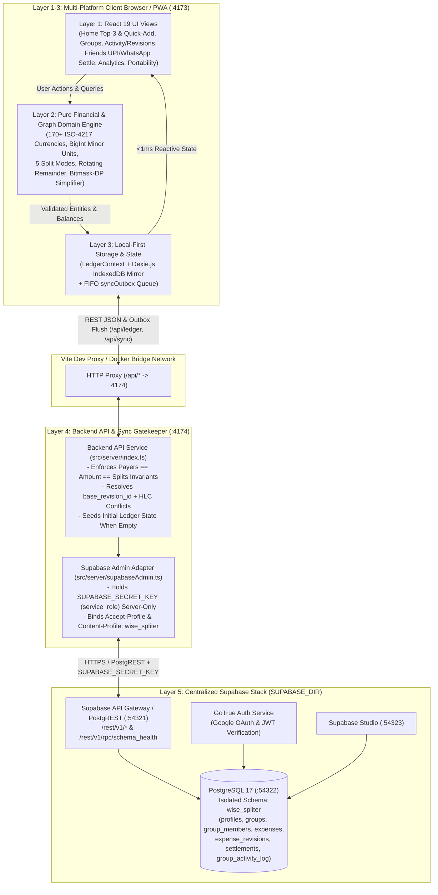
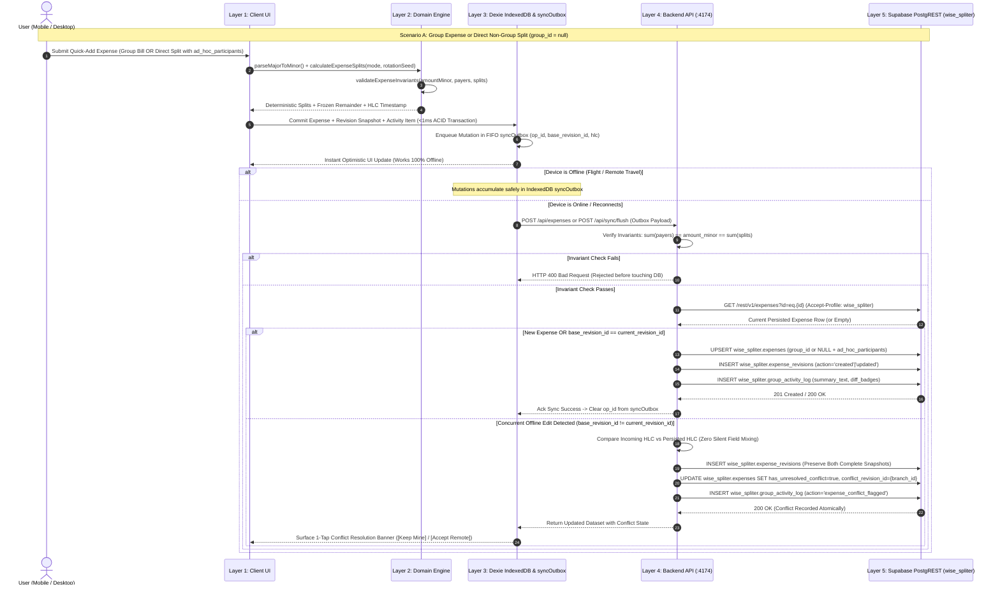
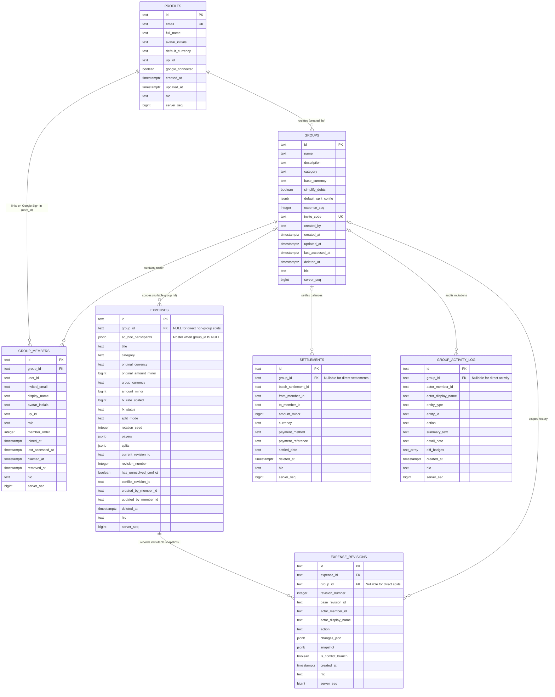

# Wise-Spliter: System Architecture & Topology

**Related Specifications:**
* [Feature Requirements](./feature-requiremrnts.md)
* [Technical Architecture & Financial Algorithms](./technical-spec.md)
* [Database Schema, Offline Sync & Security Specification (`wise_spliter`)](./database-and-sync-spec.md)
* [Engineering & Coding Standards](./coding-standards.md)

---

## 1. Top-Level Architecture Overview (5 Core Layers)

Wise-Spliter is engineered as a 5-layer local-first, mathematically deterministic, multi-platform financial ledger. Every layer has strict boundaries and responsibilities:

### Layer 1: Multi-Platform Client UI (`src/ui/`, `src/App.tsx`)
* **Minimalist Home Dashboard:** Displays at most `<= 3` recently accessed or updated active groups (`GREATEST(last_accessed_at, updated_at) DESC`), personal net balance telemetry (`Net`, `Owed to you`, `You owe`), and a 1-tap **Quick Add Expense** workflow that supports both **Direct Non-Group Splits (`group_id = null` with `ad_hoc_participants`)** and **Group Bills**.
* **Progressive Group Workspace:** Presents a clean group header with concise balance insights, member roster management (instant add by Name + optional Gmail/UPI ID), interactive **Explain This Balance** lineage drawers, and automatic contextual step-by-step guidance (`HelpGuideModal`).
* **Activity, Revision & Trash Vault (`ActivityHistoryView`):** Exposes the group-wide chronological audit feed (`group_activity_log`), per-expense immutable edit history (`expense_revisions`) with field-level before/after diffs, 1-tap conflict resolution banners (`[Keep Local Version]` / `[Accept Remote Version]`), and soft-deleted bill recovery (`deleted_at IS NOT NULL`).
* **Friends Cross-Group & UPI/WhatsApp Settle Studio (`FriendsSettleView`):** Aggregates pairwise net balances across all shared groups plus standalone direct splits, generates standard NPCI `upi://pay` deep-links and scannable Desktop UPI QR codes, formats copyable WhatsApp settlement summaries, and executes atomic multi-group batch settlements (`batch_settlement_id`).
* **Analytics & Global Search (`AnalyticsSearchView`):** Provides multi-parameter filtering (query, group, category, split mode, conflict flag) alongside category distribution breakdowns and monthly cashflow velocity.
* **Portability & Encrypted Backup Vault (`PortabilityView`):** Delivers 1-click Splitwise CSV and JSON migration imports, RFC-4180 CSV ledger exports, printable statements, and **Web Crypto (`PBKDF2-SHA256` 600,000 iterations + `AES-256-GCM`)** `.wisesplit` encrypted backup archives.

### Layer 2: Pure Financial & Graph Domain Engine (`src/domain/`)
* **Zero-Float Minor-Unit Money Math (`src/domain/money/`):** Supports 170+ ISO-4217 currencies across `0`, `2`, and `3` decimal exponents (`JPY = 0`, `INR/USD/EUR = 2`, `KWD/BHD/OMR = 3`). All parsing, formatting, and foreign-exchange conversions (`fx_rate_scaled = round(rate * 10^8)`) operate exclusively on `BigInt` and integer minor units.
* **5 Split Modes & Stateless Deterministic Rotating Remainder (`src/domain/splits/`):** Implements `equal`, `exact`, `percentage` (10,000 basis points), `shares` (Hamilton's Largest Remainder Rule), and `adjustment` (`+/-` minor units). Leftover sub-units (`T mod k`) rotate deterministically using the frozen `rotation_seed = group.expense_seq` at creation time so historical paise/cents never shift when other expenses are edited or deleted.
* **Bitmask-DP Minimum-Transfer Debt Simplifier & Provenance (`src/domain/ledger/`):** Enforces the zero-sum group conservation law ($\sum_{m} \text{Net}(m) \equiv 0\text{n}$). Supports both raw bilateral pairwise debts (`simplify_debts = false`) and exact **Bitmask Dynamic Programming ($O(3^n)$ for $n \le 16$, greedy max-heap fallback for $n > 16$)** to find the mathematically minimum number of settlement transfers ($n - p$ where $p$ is the maximum count of disjoint zero-sum subsets), paired with full **Explain This Balance** equation lineage.

### Layer 3: Local-First IndexedDB & Outbox Engine (`src/storage/local-db.ts`, `src/state/LedgerContext.tsx`)
* **Dexie.js Local Mirror (`WiseSpliterLocalDatabase`):** Mirrors `groups`, `expenses`, `expenseRevisions`, `settlements`, `groupActivityLog`, and `kvStore` inside browser `IndexedDB` (`wise_spliter_local_db`), with an automatic in-memory fallback for restricted headless contexts.
* **Sub-Millisecond Offline Reads/Writes & `syncOutbox` FIFO Queue:** Every user action commits immediately to the local state and `IndexedDB` in `< 1ms` and appends an ordered mutation record (`id`, `entityType`, `action`, `payloadJson`, `createdAt`, `hlc`) to `syncOutbox`. Whether the user is on an airplane or flaky travel Wi-Fi, the app remains 100% interactive and flushes `syncOutbox` to the Backend API when connectivity is available.

### Layer 4: Backend API & Sync Gatekeeper Service (`src/server/index.ts` & `src/server/supabaseAdmin.ts` on Port `4174`, Proxied at `/api/*`)
This layer explicitly governs **"Why we have a Backend API and Who Updates the Database"**:
* **Strict Secret Isolation:** The browser client **NEVER** holds or receives `SUPABASE_SECRET_KEY` (`service_role`). All privileged credentials remain strictly inside the Node/Bun Backend API process (`src/server/`).
* **Mathematical Invariant Gatekeeper:** Before any expense or settlement mutation touches PostgreSQL, the Backend API validates hard financial invariants:
  $$\sum_{p \in \text{payers}} p.\text{paid\_minor} == \text{amount\_minor} == \sum_{s \in \text{splits}, s.\text{included}} s.\text{owed\_minor}$$
  Payloads that violate conservation laws or have invalid split parameters are rejected with `HTTP 400` before reaching the database.
* **Atomic Conflict Resolution & HLC Ordering:** The Backend API compares incoming `base_revision_id` and monotonic **Hybrid Logical Clock (`hlc`)** timestamps against the current persisted row. Concurrent offline edits on the same expense are never silently overwritten; both snapshots are preserved in `expense_revisions`, `has_unresolved_conflict = true` is flagged, and a structured audit entry is appended to `group_activity_log`.
* **Initial Ledger Seeding & PostgREST Profile Binding:** When the `wise_spliter` schema is empty on first boot, the Backend API automatically seeds the baseline reference dataset. All database reads and writes execute atomically through `src/server/supabaseAdmin.ts` against Supabase PostgREST using explicit schema profile headers:
  * `Accept-Profile: wise_spliter`
  * `Content-Profile: wise_spliter`

### Layer 5: Centralized Local & Cloud Supabase Stack (`SUPABASE_DIR = /home/chetan/projects/my-scripts/setup/dependencies`, Schema `wise_spliter`)
* **Shared Local Supabase Infrastructure:** Connects to the centralized local Supabase stack running at `/home/chetan/projects/my-scripts/setup/dependencies` (or hosted Supabase in cloud deployments), comprising **PostgreSQL 17** (`127.0.0.1:54322`), **PostgREST Data API** (`127.0.0.1:54321`), **GoTrue Auth**, and **Supabase Studio** (`127.0.0.1:54323`).
* **Dedicated Schema Isolation (`CREATE SCHEMA wise_spliter;`):** All tables, indexes, sequences, RLS policies, and the `wise_spliter.schema_health()` readiness RPC reside exclusively inside the `wise_spliter` schema (`supabase/migrations/0001_wise_spliter_schema.sql`). Zero application tables pollute `public`, and `REVOKE ALL ON SCHEMA wise_spliter FROM PUBLIC, anon;` guarantees strict tenant and role isolation.

---

## 2. Architecture & Data-Flow Diagrams

### Diagram 1: System & Deployment Topology (`flowchart TB`)

---

### Diagram 2: Write, Offline Outbox Queue, Invariant Validation & Conflict Resolution Flow (`sequenceDiagram`)

---

### Diagram 3: `wise_spliter` Database Schema Entity-Relationship Model (`erDiagram`)

---

## 3. One-Shot Local Development & Docker Orchestration (`make dev` & `make docker-up-dev`)

Wise-Spliter is designed so a developer can boot the entire 5-layer stack with a single command (`make dev` on the host or `make docker-up-dev` in containers).

### 3.1 Host One-Shot Workflow (`make dev`)
Running `make dev` executes the following end-to-end startup pipeline:
1. **Centralized Supabase Stack Verification (`SUPABASE_DIR = /home/chetan/projects/my-scripts/setup/dependencies`):**
   * Checks whether the shared local Supabase containers (`supabase_db_dependencies` on `:54322`, PostgREST on `:54321`, Studio on `:54323`) are healthy and running; starts them from `SUPABASE_DIR` if stopped.
2. **Idempotent Schema Migration & Readiness Verification (`node scripts/apply-migration.mjs local`):**
   * Applies `supabase/migrations/0001_wise_spliter_schema.sql` to `supabase_db_dependencies` via `psql` (`ON_ERROR_STOP=1`).
   * Ensures `wise_spliter` is exposed in PostgREST schemas and reloads PostgREST (`NOTIFY pgrst, 'reload schema';`).
   * Probes every table (`profiles`, `groups`, `group_members`, `expenses`, `expense_revisions`, `settlements`, `group_activity_log`) and invokes `POST /rest/v1/rpc/schema_health` with `Accept-Profile: wise_spliter` to verify `HTTP 200` readiness.
3. **Backend API Gatekeeper Startup (`Port 4174`):**
   * Starts `src/server/index.ts` on `http://127.0.0.1:4174` with `SUPABASE_URL`, `SUPABASE_SECRET_KEY`, and `SUPABASE_SCHEMA=wise_spliter`.
   * Checks if `wise_spliter.groups` is empty and automatically seeds the initial multi-currency ledger dataset if needed.
4. **Frontend Vite Server Startup (`Port 4173`):**
   * Launches the React 19 + Vite client on `http://localhost:4173` with `/api/*` proxied directly to `http://127.0.0.1:4174`.

### 3.2 Containerized Orchestration (`make docker-up-dev`)
Running `make docker-up-dev` orchestrates the containerized development stack via Docker Compose:
* Connects the Wise-Spliter Backend (`:4174`) and Frontend (`:4173`) containers to the centralized Supabase stack via `host.docker.internal:54321` / `:54322`.
* Runs the migration verifier (`scripts/apply-migration.mjs`) prior to serving traffic so the `wise_spliter` schema is guaranteed ready before the UI accepts requests.
