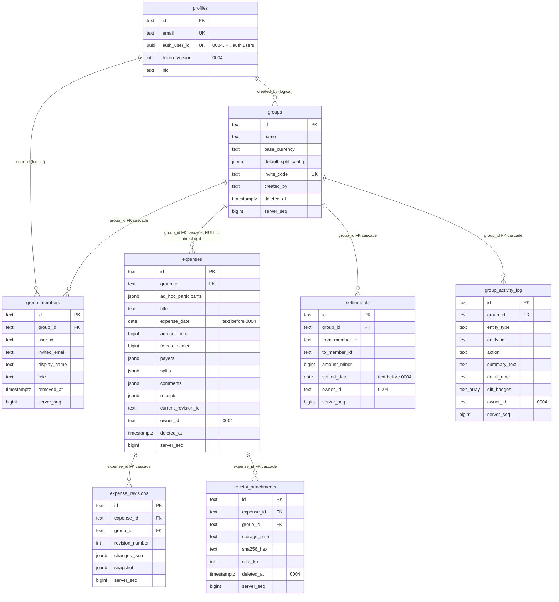

# Database capacity and data model (`wise_spliter`)

Status: measured 2026-11-15 on the local Supabase (PostgreSQL 17.11, 8 KB pages).
"Before" is migrations 0001 to 0003. "After" is 0004 (`0004_tenant_isolation_and_sync.sql`, sha256 prefix
`56335e580b704b85`, the finalized version: applied locally at 2026-11-15 18:14 UTC, and the checksum in
`wise_spliter.schema_migrations` matches the file on disk). If 0004 changes again, re-run Appendix A.

Units: B = byte, KB = 1,000 B, MB = 10^6 B, GB = 10^9 B. Every number below is measured (Section 2,
Appendix A), derived with the formula shown, or quoted from the cited source.

## Contents

1. Data model
2. Measured sizes
3. Supabase Free limits (shared project)
4. Cloudflare Workers Free limits
5. Request and egress model per daily active user (DAU)
6. Ceilings
7. Schema recommendations not yet addressed
8. Appendix A: measurement SQL and how to repeat it
9. Appendix B: production per-schema size query (read-only, for the owner)

---

## 1. Data model

All tables live in schema `wise_spliter`. Every synced table carries `hlc TEXT` (hybrid logical clock,
`<12 hex ms>-<4 hex counter>-<node id>`, 55 B stored with a UUID node) and `server_seq BIGINT` (the pull
cursor).

### 1.1 ER diagram



`schema_migrations (version, checksum, applied_at)` is the migration ledger added by 0004; it holds one row
per migration file.

### 1.2 Tables, columns, indexes, RLS

| Table | Purpose | Key columns and types | Indexes after 0004 (before-only indexes in brackets) |
|---|---|---|---|
| `profiles` | One row per signed-in person | `id text`, `email text` (lowercase, CHECK), `auth_user_id uuid` (0004), `token_version int` (0004), `default_currency text`, `hlc text`. `server_seq` dropped in 0004. fillfactor 90 (0004) | pkey(id), unique(email), unique(auth_user_id). [lower(email)] |
| `groups` | Ledger container, base currency, debt simplification flag | `id text`, `name`, `base_currency`, `default_split_config jsonb`, `expense_seq int`, `invite_code text`, `created_by text`, `deleted_at`, `server_seq` | pkey(id), unique(invite_code), (created_by). [(server_seq), (GREATEST(last_accessed_at, updated_at) DESC) partial] |
| `group_members` | Members and unclaimed placeholders of a group | `group_id text FK`, `user_id text` (NULL until claimed), `invited_email text`, `display_name`, `role` CHECK, `removed_at`, `server_seq` | pkey(id), (group_id, server_seq), unique (user_id, group_id) WHERE active and claimed, (invited_email) WHERE unclaimed, (user_id) WHERE claimed. [(group_id), (group_id, user_id) partial, (group_id, lower(invited_email)) partial] |
| `expenses` | Current state of each bill; `group_id NULL` = direct non-group split | money in `bigint` minor units, `fx_rate_scaled bigint`, `payers/splits/comments/receipts/ad_hoc_participants jsonb`, `expense_date date` (text before 0004), `owner_id text` (0004), `deleted_at` (soft delete) | pkey(id), (group_id, server_seq), (owner_id, server_seq) WHERE group_id IS NULL, GIN(ad_hoc_participants jsonb_path_ops) WHERE group_id IS NULL. [(group_id), (created_by_member_id) partial] |
| `expense_revisions` | Append-only edit history with a full `snapshot jsonb` per revision | `expense_id FK`, `revision_number int`, `changes_json jsonb`, `snapshot jsonb`, `is_conflict_branch bool` | pkey(id), (expense_id, revision_number DESC), (group_id, server_seq) |
| `settlements` | Recorded repayments | `from_member_id`, `to_member_id`, `amount_minor bigint`, `currency`, `payment_method` CHECK, `settled_date date` (text before 0004), `owner_id` (0004) | pkey(id), (group_id, server_seq), (owner_id), (from_member_id), (to_member_id), the last three WHERE group_id IS NULL |
| `group_activity_log` | Append-only human-readable feed | `entity_type`, `entity_id`, `action`, `summary_text`, `detail_note`, `diff_badges text[]`, `owner_id` (0004) | pkey(id), (group_id, server_seq), (owner_id) and (entity_id) WHERE group_id IS NULL |
| `receipt_attachments` | Receipt pointer only; image bytes stay on the device | `expense_id FK`, `storage_path text`, `sha256_hex text` (64 hex, CHECK), `size_kb int`, `mime_type` CHECK, `deleted_at` (0004). `storage_bucket` and `data_url` dropped in 0004 | pkey(id), (group_id, server_seq), (expense_id). [(expense_id) under the old name] |

0004 also adds triggers: `trg_assign_server_seq` (BEFORE INSERT) and `trg_bump_server_seq` (BEFORE
UPDATE) draw `server_seq` from one shared `change_seq` after taking transaction advisory lock 7735001, so
sequence values become visible in commit order (there is no column default, so the value is drawn only
after the lock; the lock serializes all synced writes), `trg_row_caps` (per-tenant row caps, for example 20,000 expenses per group, 500 revisions per
expense, 20 receipts per expense), `trg_expense_member_scope` (payers and splits must be active members),
and immutability triggers on owner and receipt identity columns.

**RLS.** Before 0004: RLS enabled and forced on all eight tables, with SELECT/INSERT/UPDATE policies for
`authenticated` built on `is_group_member()`, `can_access_expense()` and
`is_standalone_expense_participant()` (0002). After 0004: RLS stays enabled and forced; `anon` and
`authenticated` have no table or function grants; only SELECT policies remain (one per table, same
membership predicates, `profiles` matched on `auth_user_id = auth.uid()`). The API connects as
`service_role`, which has `BYPASSRLS` (checked locally: `rolbypassrls = t`), so for API traffic the
authorization boundary is the SECURITY DEFINER RPCs `push_mutations(actor, mutations)` and
`pull_changes(actor, cursor, limit)`, which re-check membership per mutation. The policies are defense in
depth.

### 1.3 What each user action writes

Rows that land in Postgres, from the client code in `src/state/LedgerContext.tsx` and the 0004 rules in
`apply_mutation`. Receipt image bytes never reach the server: 0003 forbids `data_url` and Storage objects,
and the client keeps the blob in IndexedDB (`local_receipt_blobs`); only the pointer row is synced.

| Action | Before 0004 (git HEAD client, full re-upsert) | After 0004 (outbox push to `push_mutations`) |
|---|---|---|
| Create expense | INSERT expense, INSERT v1 revision (full snapshot), INSERT activity `expense_created`; group row rewritten (`expense_seq`, `updated_at`) | INSERT expense, INSERT activity `expense_created`. The v1 revision is pushed but not stored (`derived_from_expense`). Group row UPDATE only because the client increments `expense_seq` |
| Edit expense | UPDATE expense (new tuple), INSERT revision (full snapshot), INSERT activity `expense_updated`; group row rewritten | UPDATE expense, INSERT revision, INSERT activity. On the first edit the server also stores the prior state as the v1 revision (a second full snapshot), which "Keep Theirs" conflict resolution needs. The group row is not rewritten: `updated_at` and `last_accessed_at` are per-device fields and the server skips group UPDATEs when no shared field changed (`no_shared_change`) |
| Delete expense | UPDATE `deleted_at` (soft delete), INSERT activity `expense_deleted` | Same |
| Settlement | INSERT settlement, INSERT activity `settlement_recorded` | Same |
| Create group with N members | INSERT group, INSERT creator member, INSERT activity `group_created`; each added member: INSERT member, INSERT activity `member_added`, UPDATE group | Same |
| Add member | INSERT member, INSERT activity, UPDATE group | Same |
| Remove member | No client action writes `removed_at` today. The schema supports it as an UPDATE of `removed_at` (no net growth after vacuum) | Same |
| Attach receipt pointer | INSERT pointer row, and the same metadata is copied into `expenses.receipts` (expense row rewritten) | Same; pointer pushed as `receipt_pointer` |

Every UPDATE leaves a dead tuple until vacuum. Before 0004 the sync path re-upserted every row on every
sync (Section 2.4). After 0004 only changed rows are written, but every UPDATE bumps `server_seq`, which is
indexed, so no UPDATE on a synced table can be HOT (heap-only).

---

## 2. Measured sizes

### 2.1 Methodology

- Local Supabase only. One `psql` session: `BEGIN`, build clones, insert synthetic rows, measure,
  `ROLLBACK`. Nothing is written to `wise_spliter` tables.
- Clones: `CREATE TEMP TABLE t_x (LIKE <schema>.x INCLUDING ALL)` copies columns, defaults, identity,
  CHECK constraints, every index (partial and expression included) and storage options. Triggers and FKs
  are not copied (they do not change row size).
  - Before: the table and index DDL of 0001 to 0003 is replayed into a scratch schema `ws_cap0003`
    inside the same transaction (Appendix A, `build_0003.py`) and cloned from there.
  - After: cloned from the live `wise_spliter` schema (0004 applied). 0004 assigns `server_seq` by
    trigger, which is not cloned, so the clones get a temp-sequence default; the shared `change_seq` is
    never advanced.
- Sample: G = 1,000 groups, K = 4 members per group (the split count; every expense splits 4 ways and has
  1 payer), E = 20 expenses per group, giving 20,000 expenses, 20,000 revisions per revision type, 20,000
  activity rows per action type, 20,000 settlements, 20,000 receipt pointers, 4,000 members, 1,000 groups
  and 1,000 profiles. Text follows the client templates (titles about 24 characters, activity summaries
  from the same format strings); user ids are 36-character auth UUIDs, as for Google sign-ins.
- Metric: `pg_total_relation_size(t) / rows` = (heap + TOAST + FSM/VM + all indexes) per row. Each table
  also carries a fixed 32,768 B (empty TOAST relation and its index), which adds 1.6 B per row at 20,000
  rows and 33 B per row on the 1,000-row `groups` and `profiles` samples.
- JSON size = `avg(octet_length(row_to_json(row)::text))`, the shape PostgREST and `to_jsonb` return; used
  for egress.
- Leftover check (Appendix A, `fp.sql`), run before and after each run: row count and `max(hlc)` of all
  eight tables, `change_seq.last_value`, total `wise_spliter` bytes, and absence of `ws_cap0003`. All
  identical across the final runs (`wise_spliter` total 7,593,984 B, `change_seq` 176020). Re-running against
  the finalized 0004 reproduced every number of the earlier 0004 run byte for byte: the final changes are
  trigger and RPC logic, not row layout.

### 2.2 Bytes per row

| Table / row type | Before: total B/row | Before: heap / idx | After: total B/row | After: heap / idx | JSON B/row (after) |
|---|---:|---:|---:|---:|---:|
| profiles | 492 | 205 / 254 | 483 | 221 / 229 | 433 |
| groups | 565 | 279 / 254 | 508 | 279 / 197 | 541 |
| group_members | 469 | 223 / 238 | 434 | 223 / 203 | 449 |
| expenses (4-way split) | 1,503 | 1,366 / 136 | 1,491 | 1,366 / 124 | 1,602 |
| expense_revisions, v1 `created` | 1,844 | 1,638 / 204 | 1,844 | 1,638 / 204 | 1,464 |
| expense_revisions, edit | 1,844 | 1,638 / 204 | 1,844 | 1,638 / 204 | 1,528 |
| activity `expense_created` | 497 | 373 / 123 | 535 | 410 / 124 | 566 |
| activity `expense_updated` | 515 | 390 / 123 | 557 | 431 / 124 | 581 |
| activity `expense_deleted` | 556 | 431 / 123 | 596 | 470 / 124 | 623 |
| activity `settlement_recorded` | 481 | 356 / 123 | 516 | 390 / 124 | 551 |
| activity `group_created` | 532 | 377 / 123 | 582 | 410 / 139 | 574 |
| activity `member_added` | 571 | 456 / 104 | 603 | 483 / 109 | 642 |
| settlements | 359 | 234 / 123 | 390 | 265 / 124 | 491 |
| receipt_attachments (pointer) | 661 | 455 / 204 | 637 | 431 / 204 | 598 |

Observations from the same run:

- Page packing dominates. An expense tuple is 1,256 B (1,289 B after 0004, `pg_column_size(row)`), so
  6 fit in an 8 KB page and each costs 8,192 / 6 = 1,366 B of heap. A revision tuple is 1,488 B, 5 per
  page, 1,638 B each. Small row changes inside the same rows-per-page band change nothing on disk; this is
  why 0004's `expense_date` text-to-date saving (11 B to 4 B) and its new `owner_id` (+37 B) both leave
  expense heap at 1,366 B.
- Inside an expense: `splits` jsonb 758 B, `payers` 109 B. Inside a v1 revision: `snapshot` 1,134 B,
  `changes_json` 122 B. Activity text (`summary_text` + `detail_note`) 91 B, `diff_badges` 53 B.
- Rows stay under the roughly 2 KB TOAST threshold, so nothing is compressed or moved to TOAST.
- 0004 per-row effect: indexes shrink (expenses 136 to 124 B, groups 254 to 197 B, members 238 to 203 B);
  activity and settlements grow 31 to 50 B from `owner_id` (36-char id on every row).

### 2.3 Bytes per action

Formula: sum of the B/row of every row the action stores (Section 1.3). Transient dead tuples from UPDATEs
are excluded (they are reclaimed for reuse by vacuum).

| Action | Before 0004 | After 0004 |
|---|---:|---:|
| Create expense | 1,503 + 1,844 + 497 = **3,844 B** | 1,491 + 535 = **2,026 B** (expense + activity) |
| Edit expense, later edits | 1,844 + 515 = **2,359 B** | 1,844 + 557 = **2,401 B** |
| Edit expense, first edit | 2,359 B | 1,844 (lazy v1) + 1,844 + 557 = **4,245 B** |
| Delete expense | **556 B** | **596 B** |
| Settlement | 359 + 481 = **840 B** | 390 + 516 = **906 B** |
| Create group, N members | 565 + 469N + 532 + 571(N-1); N = 4: **4,686 B** | 508 + 434N + 582 + 603(N-1); N = 4: **4,635 B** |
| Add member | 469 + 571 = **1,040 B** | 434 + 603 = **1,037 B** |
| Attach receipt pointer | 661 B row + 541 B copied into `expenses.receipts` | 637 B row + 541 B copied |

The receipt copy has a page-packing cost: a 1,256 B expense tuple plus 541 B is 1,797 B, MAXALIGN 1,800 B
plus a 4 B line pointer, so floor(8,168 / 1,804) = 4 rows per page and heap per expense rises from 1,366
to 2,048 B (+682 B). Pointer total about 661 + 682 = 1,343 B (derived).

A lazily stored v1 (empty actor name, `changes_json = []`) still measures 1,844 B: it stays in the
5-per-page band.

### 2.4 Full re-upsert bloat (old `/api/ledger/sync`)

20,000 expenses re-upserted once with `INSERT ... ON CONFLICT (id) DO UPDATE` of every column, as the git
HEAD API did on every sync:

| | Before 0004 schema | After 0004 schema |
|---|---:|---:|
| Total before | 30,064,640 B | 29,827,072 B |
| Total after | 57,966,592 B | 57,597,952 B |
| Growth | **92.8 %** | 93.1 % |
| Heap | 27.3 MB to 54.6 MB | same |

The same run proves a correctness bug in the old path: `server_seq` was unchanged after the upsert
(`server_seq_unchanged_by_upsert = t`), so a cursor pull would never see edits. 0004 fixes it with
`trg_bump_server_seq` (the clone has no triggers, so the after-schema row shows the pre-trigger value).

### 2.6 Reconciliation with the server agent's 0004 figures

| Action | Server agent (own sample) | This document |
|---|---:|---:|
| New expense | 1,622 B | 2,026 B |
| First edit | 4,981 B | 4,245 B |
| Later edit | 3,289 B | 2,401 B |
| Settlement | 668 B | 906 B |
| 4-member group | 1,445 B | 4,635 B (2,826 B without the 3 `member_added` activity rows) |

The two samples differ in content and method, and the server agent's script was not available to
inspect. Its group figure is below the measured cost of the group row plus four member rows alone
(508 + 4 x 434 = 2,244 B), which points to a method that counts tuple bytes landing in partly filled
pages and leaves out index growth, page packing, or the activity rows. Its edit figures are higher than
the stored rows measured here, which is consistent with counting the dead expense tuple (1,366 B heap)
that an UPDATE leaves until vacuum. This document uses its own numbers: each is a full
`pg_total_relation_size` divided by 20,000 (or 1,000 / 4,000) rows of the exact row shapes in Section 1.3.

### 2.5 Cross-check against the previous measurement

| Item | Previous | This run (before 0004) |
|---|---:|---:|
| expenses | 1,541 B | 1,503 B |
| expense_revisions | 1,859 B | 1,844 B |
| group_activity_log | 530 B | 481 to 571 B by action |
| group_members | 681 B | 469 B |
| groups | 717 B | 565 B |
| settlements | 428 B | 359 B |
| receipt pointer | 705 B | 661 B |
| New expense | 3.9 KB | 3.84 KB |
| Edit | 2.4 KB | 2.36 KB |
| Settlement | 0.96 KB | 0.84 KB |
| 4-member group (group + 4 members + 1 activity) | 4.0 KB | 2.97 KB (4.69 KB with the 3 `member_added` rows the client also writes) |
| Full re-upsert of 20k expenses | +93 % (30.8 to 59.5 MB) | +92.8 % (30.1 to 58.0 MB) |

Expenses, revisions, the per-action expense costs and the bloat figure agree within 3 %. Members, groups
and settlements are 16 to 31 % lower here. The previous script is not available, so the cause cannot be
confirmed; the likely contributors are sample size (fixed overhead on small samples) and synthetic text
lengths. This document uses its own numbers throughout.

---

## 3. Supabase Free limits (shared project)

**This app shares the production Supabase project and organization with another app (merry-tools, in its
own schema).** Database size, disk, egress, MAU, Realtime and the inactivity timer are therefore shared
between both apps. wise_spliter does not use Supabase Realtime (no client channel subscriptions), so the
Realtime quotas are available to merry-tools.

Sources, fetched 2026-11-15: https://supabase.com/pricing and
https://supabase.com/docs/guides/platform/database-size (page dated Nov 2, 2026).

| Limit | Free plan value | Source wording |
|---|---|---|
| Database size | 500 MB | Pricing: "500 MB database size"; table: "500 MB database size per project included". Docs: the 500 MB quota "is evaluated per organization, summing the database size across all of your projects" and "is based on the average daily database size over the billing period"; exceeding it can trigger a Fair Use restriction (HTTP 402) |
| Disk | 2 GB, read-only at 95 % | Docs: "Free Plan projects have a fixed disk size of 2 GB. The disk does not autoscale. When disk usage reaches 95%, Supabase puts your database into read-only mode." WAL counts toward disk |
| Egress | 5 GB (+ 5 GB cached egress) | Pricing: "5 GB egress", "5 GB cached egress" |
| Realtime concurrent connections | 200 | Pricing: "Concurrent Peak Connections 200 included" |
| Realtime messages | 2 million / month | Pricing: "Messages Per Month 2 Million included" |
| Monthly active users | 50,000 | Pricing: "50,000 monthly active users" |
| Pausing | after 1 week of inactivity | Pricing: "Free projects are paused after 1 week of inactivity." |
| Active projects | 2 | Pricing: "Limit of 2 active projects." |

The docs also state that a new project already uses about 40 to 60 MB ("New Supabase projects have a
database size of ~40-60mb"). That baseline plus merry-tools' schema comes out of the same 500 MB, which
is why Section 6 assumes about 300 MB is available to `wise_spliter`. The owner should replace that
assumption with the real figure from Appendix B.

---

## 4. Cloudflare Workers Free limits

Source, fetched 2026-11-15: https://developers.cloudflare.com/workers/platform/limits/

| Limit | Workers Free | Source wording |
|---|---|---|
| Requests | 100,000 per day, per account | "Accounts on the Workers Free plan have a daily request limit of 100,000 requests, resetting at midnight UTC. When a Worker exceeds this limit, Cloudflare returns Error 1027." |
| CPU time | 10 ms per request | Account plan limits table: "CPU time 10 ms" |
| Workers per account | 100 | "Workers per account 100" |
| Subrequests | 50 per request | "Subrequests per invocation 50" |
| Memory | 128 MB | Account plan limits table |

What this means when one free account hosts many projects:

- The 100,000 requests are one pool for every Worker on the account. If merry-tools, this API and other
  projects share the account, their traffic adds up, and when the pool is spent every Worker on the
  account fails (Error 1027, or bypasses the Worker if its route is set to fail open) until midnight UTC.
- Each project should get a request budget. Example: if this API may use 50 % of the account, its
  ceiling is 50,000 requests per day; Section 5 converts that into DAU.
- A CORS preflight (`OPTIONS`) is an HTTP request to the Worker, so it consumes the same pool. Native
  (Capacitor) builds call the API cross-origin and pay for preflights; the same-origin web build does not.
- 10 ms CPU rules out per-request work that grows with total data, such as the old path that parsed and
  validated the user's entire dataset on every sync (not measured here). The new path handles at most 200
  mutations (`SYNC_PUSH_MAX_MUTATIONS`) or 500 rows (`SYNC_PULL_MAX_LIMIT`) per call.
- Subrequests: the old `/api/ledger/sync` made up to 16 Supabase calls (2 group-ownership reads, 6
  entity-ownership reads, up to 8 table upserts); the new push and pull are one RPC each. Both fit in 50.

---

## 5. Request and egress model per DAU

Assumptions (stated, not measured): 3 app opens per day, 2 expense writes per day (treated as creates),
0.15 settlements per day, groups of 4 members where every member behaves the same.

### 5.1 Old design (git HEAD `0ace179`): full-snapshot sync

Code facts: every change to the in-memory dataset POSTs the whole dataset to `/api/ledger/sync`
(`LedgerContext.tsx` effect on `dataset`); opening a group sets `lastAccessedAt`, which is a dataset
change; the backend session token is cached in memory only, so each cold open exchanges the Google token at
`/api/auth/google`, which returns the dataset from `fetchDatasetFromSupabase()`; the server sends no
`Access-Control-Max-Age`.

| Calls per day | Count |
|---|---:|
| Per open: token exchange + mount sync + open-group sync = 3; times 3 opens | 9 |
| Expense writes, 1 sync each | 2 |
| Settlements, 1 sync each | 0.15 |
| **Total API calls** | **11.15** |
| Native: every call is a non-simple POST and without `Access-Control-Max-Age` the preflight is not reused (Fetch standard default 5 s), so x2 | **22.3** |

Supabase egress (database to API). The old reads were not scoped to the user: `fetchDatasetFromSupabase`
reads `select *` from six tables for all tenants, and every sync reads ownership columns of eight
row-sets for all tenants. PostgREST caps each read at `max_rows` (1000 in `supabase/config.toml`; check
the hosted project's API "Max rows" setting), which also silently truncated those reads once any table
passed 1,000 rows.

- Full read per open at the cap, JSON B/row from Section 2 (before):
  1,000 x (groups 541 + members 449 + expenses 1,552 + revisions 1,463 + settlements 439 + activity 515)
  = 1,000 x 4,959 B = **4.96 MB**
- Ownership reads per sync at the cap (Appendix A, section 6 of the output):
  1,000 x (83 + 157 + 139 + 151 + 66 + 119 + 141 + 116) = 1,000 x 972 B = **0.97 MB**
- Syncs per day: 3 x 2 + 2.15 = 8.15
- Per DAU per day: 3 x 4.96 MB + 8.15 x 0.97 MB = 14.88 + 7.92 = **22.8 MB** (the previous estimate was
  about 24 MB). Below the cap the formula is
  `3 x sum_t(min(n_t, 1000) x json_t) + 8.15 x sum_t(min(n_t, 1000) x proj_t)` where `n_t` counts all
  tenants' rows, so cost per user grows with the total user base. The cap is reached quickly: the
  activity table passes 1,000 rows after about 1,000 / 2.15 = 465 DAU-days.
- Free egress per day: 5 GB / 30 = 166.7 MB; 166.7 / 22.8 = **7.3 DAU**. The old design cannot serve
  more than single-digit DAU on the Free plan.

### 5.2 New design (working tree, 2026-11-15): outbox delta push and cursor pull

Code facts: changes are diffed into an IndexedDB outbox and pushed after a 1,500 ms debounce
(`SYNC_DEBOUNCE_MS`); each sync run pushes the outbox (if not empty) then pulls from the stored cursor;
an open or visibility change triggers one sync; the session token lives 7 days and is refreshed within a
day of expiry; the server sends `Access-Control-Max-Age: 600`.

| Calls per day | Count |
|---|---:|
| Opens: 1 pull each | 3 |
| Expense writes: 1 push + 1 pull each | 4 |
| Settlements: 1 push + 1 pull each | 0.3 |
| Token refresh: at most 1 per 6 days | 0.17 |
| **Total API calls (web, same origin)** | **7.5** |
| If the pull after a push is folded into the push response | 5.5 (about 6) |
| Native upper bound: preflight cache is keyed by URL and the pull URL carries the cursor, so up to 1 preflight per pull (5.15) plus at most 1 per push (2.15) | up to **14.8** |

Supabase egress: `pull_changes` returns only rows of the actor's groups and direct splits with
`server_seq > cursor`, including the actor's own pushed rows. Each group expense create also bumps the
group row (`expense_seq`), so the group row (541 B JSON) is pulled again by every member; edits no
longer touch the group row. Per member per day, using after-0004 JSON sizes (a create stores the expense
and its `expense_created` activity):

- 2 x (expense 1,602 + activity 566 + group 541) B + 0.15 x (settlement 491 + activity 551) B
  = 5,418 + 156 = **5,574 B**
- Per active 4-member group per day: 4 x 5,574 = **22.3 KB**
- For a user in 2 to 3 active groups: **45 to 67 KB per day**, plus a per-change envelope and HTTP
  overhead that were not measured. Push requests are ingress to Supabase, not egress.
- Free egress ceiling at 67 KB per DAU per day: 5 GB / (67 KB x 30) = **about 2,500 DAU**.

---

## 6. Ceilings

Assumptions: 300 MB available to `wise_spliter` (Section 3); 30-day months; 2 expense creates and 0.15
settlements per DAU per day; new sync design for the egress and request columns.

Growth per DAU per month:

- Before 0004: (2 x 3,844 + 0.15 x 840) x 30 = 7,814 x 30 = **234.4 KB**
- After 0004: (2 x 2,026 + 0.15 x 906) x 30 = 4,188 x 30 = **125.6 KB**
- Months to fill = 300 MB / (DAU x growth per DAU per month)

| DAU | Expenses / month | Before 0004: months to 300 MB | Before, with full re-upsert bloat (/1.928) | After 0004: months to 300 MB | Egress / month (new design, 67 KB/DAU/day) | Worker requests / day (web; native upper bound) | Binds first |
|---:|---:|---:|---:|---:|---:|---:|---|
| 50 | 3,000 | 25.6 | 13.3 | 47.8 | 100 MB (2.0 % of 5 GB) | 375; 740 | Old design: egress (over quota above 7.3 DAU). New design: DB size, in about 4 years |
| 100 | 6,000 | 12.8 | 6.6 | 23.9 | 200 MB (4.0 %) | 750; 1,480 | DB size |
| 300 | 18,000 | 4.3 | 2.2 | 8.0 | 600 MB (12 %) | 2,250; 4,440 | DB size |
| 1,000 | 60,000 | 1.3 | 0.66 | 2.4 | 2.0 GB (40 %) | 7,500; 14,800 (7.5 to 14.8 % of the account pool) | DB size; egress next at about 2,500 DAU |

Notes:

- Old design egress at these scales: 22.8 MB x 30 x DAU = 34 GB (50 DAU) to 684 GB (1,000 DAU) per month,
  7 to 137 times the 5 GB quota. Egress binds first for the old design at every row of the table.
- Edit-heavy usage moves the after-0004 numbers: an expense created and edited once costs
  2,026 + 4,245 = 6,271 B after 0004 versus 3,844 + 2,359 = 6,203 B before, so 0004 saves storage only
  on expenses that are never edited.
- MAU (50,000) does not bind unless DAU/MAU falls below 1,000 / 50,000 = 2 % at 1,000 DAU.
- The 2 GB disk (read-only at 95 %) includes WAL and dead tuples, so keep live size well under it; the
  500 MB billing quota is computed on the organization's average daily size.
- All quota figures are shared with merry-tools (Section 3) and with other Workers on the account
  (Section 4).

---

## 7. Schema recommendations not yet addressed

Ranked by bytes saved per DAU (storage first, then egress). Savings are against the after-0004 numbers unless noted.

| # | Recommendation | Measured or derived saving | Notes |
|---|---|---|---|
| 1 | **Store splits as positional arrays** `[memberId, owedMinor, originalOwedMinor, rawInputValue, remainderMinor]` instead of objects with repeated keys (or at least short keys) | `splits` 758 to 370 B; expense row **1,491 to 1,099 B (-392 B, -26 %)**; JSON 1,602 to 1,208 B. Per DAU: -784 B/day, which moves 1,000 DAU from 2.4 to 2.9 months | Do **not** normalize into a split table: measured 820 B per expense (4 rows + PK) versus 758 B jsonb. The same encoding applies to `payers` and the revision `snapshot` (not measured separately) |
| 2 | **Revisions: store one snapshot per edit, not two.** Keep the replaced state (the v1 that "Keep Theirs" needs) and leave the new revision's snapshot empty until it is itself replaced, since the current state is the expense row; or store `changes_json` diffs only | Revision without snapshot: **1,844 to 578 B (-1,266 B, -69 %)** per edit. Under 0004 the first edit writes two full snapshots (4,245 B); this brings it to 1,844 + 578 + 557 = 2,979 B | 0004 already avoids the v1 snapshot on create |
| 3 | **Retention for `group_activity_log` and `expense_revisions`** | Bounds growth instead of shrinking rows: with a 180-day window, activity stops growing after 180 days | 0004 adds row caps (100,000 activity rows per group, 500 revisions per expense), not time-based retention. A scheduled `DELETE` in batches (pg_cron) plus vacuum keeps the files flat |
| 4 | **Derive activity rows on the client**; where a row is kept, store structured fields only (`entity_type`, `entity_id`, `action`, actor, time) and render text on device | Not storing `expense_created` saves **535 B per create (26 % of the 2,026 B create)**; slim row (no summary, detail, badges, actor name): **535 to 390 B (-145 B, -27 %)**. `settlement_recorded` (516 B) is derivable from the settlement, `expense_updated` (557 B) from the revision, `expense_deleted` (596 B) from `deleted_at` | The final 0004 stores `expense_created` again (an earlier draft derived it) |
| 5 | **Drop the receipt copy in `expenses.receipts`**; keep only `receipt_attachments` | 541 B jsonb per receipt, which pushes the expense to 4 rows per page: **-682 B heap per receipt-bearing expense** (derived, Section 2.3) | The pointer table already carries every field |
| 6 | **Stop rewriting the group row on expense creates**: the client still increments `expense_seq` (`LedgerContext.tsx`), which is a shared field, so 0004 still writes the group on every create; derive the counter on device | Saves **541 B of pull egress per member per create** (about 4.3 KB per DAU per day in a 4-member group, about a fifth of the per-group total) and one non-HOT group UPDATE (dead 279 B heap tuple plus 3 index entries) per create | 0004 already skips group writes when only per-device fields (`updated_at`, `last_accessed_at`) change, so edits no longer rewrite the group |
| 7 | **Autovacuum tuning for update-heavy tables** (`expenses`, `groups`, `group_members`): `ALTER TABLE ... SET (autovacuum_vacuum_scale_factor = 0.05, autovacuum_vacuum_threshold = 50)` | Caps dead space instead of the default 20 % of the table. Worst case measured: a full rewrite adds 93 % | Under 0004 every UPDATE bumps the indexed `server_seq`, so no update is HOT and **fillfactor below 100 brings no HOT benefit** on synced tables (it does on `profiles`, where 0004 set 90) |
| 8 | **`owner_id` only on direct rows** (`group_id IS NULL`); group rows get access from the group | Activity **535 to 498 B (-37 B)**; expenses 0 B today (same rows-per-page band) but it compounds with #1 | Needs `chk_settlements_owner` and `chk_group_activity_owner` relaxed for group rows |
| 9 | Shorter HLC and ids: `hlc` is 55 B on every row, ids 18 to 39 B (`current_revision_id` 39 B) | Up to about 27 B per row for a binary HLC (8 B ms + 4 B counter + 16 B uuid); not measured | Low value for a wide migration; do only together with another rewrite |
| 10 | TOAST / compression tuning | **Measured no effect**: `toast_tuple_target = 128` plus `lz4` on `snapshot` and `changes_json` left revisions at 1,844 B | Rows are under the roughly 2 KB TOAST threshold. Revisit only if rows grow past it |
| 11 | Redundant indexes | None left after 0004 | 0004 removed the prefix duplicates and the expression index that blocked HOT. Remaining cost: 124 B per expense, 204 B per revision, 124 B per activity row |

Combined effect on the ceilings, per DAU per month:

- #1 alone: (2 x (1,099 + 535) + 0.15 x 906) x 30 = 102.1 KB; 300 MB lasts 58.8 / 29.4 / 9.8 / 2.9
  months at 50 / 100 / 300 / 1,000 DAU.
- #1 and not storing `expense_created` (#4): (2 x 1,099 + 0.15 x 906) x 30 = 70.0 KB; 85.7 / 42.8 /
  14.3 / 4.3 months.

---

## 8. Appendix A: measurement SQL and how to repeat it

Requirements: the local Supabase DB container (`supabase_db_dependencies`), the repo migrations, Python 3.
Never point these scripts at production.

Files (keep them in a scratch directory outside the repo):

- `build_0003.py` extracts the table and index DDL of 0001 to 0003 into scratch schema `ws_cap0003`.
- `measure.sql` is the body (below).
- `run_before.sql` = header + `scratch_0003.sql` + `\set src ws_cap0003` + `measure.sql` + `ROLLBACK;`
- `run_after.sql` = header + `\set src wise_spliter` + `measure.sql` + `ROLLBACK;`
- `fp.sql` is the leftover check, run before and after; the two outputs must be identical.

```bash
M=path/to/wise-spliter/supabase/migrations
python3 -I build_0003.py $M/0001_wise_spliter_schema.sql \
  $M/0002_wise_spliter_security_hardening.sql $M/0003_local_only_receipt_pointers.sql > scratch_0003.sql
hdr='\set ON_ERROR_STOP on
\set G 1000
\set K 4
\set E 20
\pset footer off
BEGIN;'
{ echo "$hdr"; cat scratch_0003.sql; echo '\set src ws_cap0003'; cat measure.sql; echo 'ROLLBACK;'; } > run_before.sql
{ echo "$hdr"; echo '\set src wise_spliter'; cat measure.sql; echo 'ROLLBACK;'; } > run_after.sql
docker exec -i supabase_db_dependencies psql -U postgres -At < fp.sql > fp_before.txt
for m in before after; do
  docker exec -i supabase_db_dependencies psql -U postgres -X < run_$m.sql > out_$m.txt
done
docker exec -i supabase_db_dependencies psql -U postgres -At < fp.sql > fp_after.txt
diff fp_before.txt fp_after.txt && echo "nothing left behind"
```

Change `G`, `K` (members and split count) and `E` (expenses per group) in the header to resize the sample.

### build_0003.py

```python
# Emits only the table/index DDL of migrations 0001-0003, renamed into scratch schema ws_cap0003.
import re, sys
out = []
for f in sys.argv[1:]:
    stmts, buf, in_dollar = [], [], False
    for line in open(f).read().splitlines():
        if line.strip().startswith('--'):
            continue
        buf.append(line)
        if line.count('$$') % 2:
            in_dollar = not in_dollar
        if not in_dollar and line.rstrip().endswith(';'):
            stmts.append('\n'.join(buf)); buf = []
    out += [s.replace('wise_spliter', 'ws_cap0003') for s in stmts
            if re.match(r'\s*(CREATE SCHEMA|CREATE TABLE|CREATE INDEX|ALTER TABLE)', s)]
print('\n'.join(out))
```

### fp.sql

```sql
select t, (xpath('/row/c/text()', query_to_xml(format('select count(*) c from wise_spliter.%I', t), false, true, '')))[1]::text cnt,
 (xpath('/row/m/text()', query_to_xml(format('select coalesce(max(hlc),'''') m from wise_spliter.%I', t), false, true, '')))[1]::text max_hlc
from unnest(array['profiles','groups','group_members','expenses','expense_revisions','settlements','group_activity_log','receipt_attachments']) t;
select 'change_seq', last_value, is_called from wise_spliter.change_seq;
select 'scratch_schema_exists', count(*) from pg_namespace where nspname = 'ws_cap0003';
select 'wise_spliter_bytes', sum(pg_total_relation_size(c.oid)) from pg_class c where c.relnamespace = 'wise_spliter'::regnamespace and c.relkind in ('r','p','m');
```

### measure.sql

```sql
-- wise_spliter capacity measurement body. LOCAL Supabase only.
-- Included by run_before.sql / run_after.sql, which own BEGIN ... ROLLBACK and set :src, :G, :K, :E.

-- Clones carry defaults, identity, CHECKs, indexes (incl. partial/expression) and storage settings.
-- Triggers and foreign keys are not cloned (they do not change row size).
CREATE TEMP TABLE t_profiles    (LIKE :src.profiles            INCLUDING ALL);
CREATE TEMP TABLE t_groups      (LIKE :src.groups              INCLUDING ALL);
CREATE TEMP TABLE t_members     (LIKE :src.group_members       INCLUDING ALL);
CREATE TEMP TABLE t_expenses    (LIKE :src.expenses            INCLUDING ALL);
CREATE TEMP TABLE t_rev_v1      (LIKE :src.expense_revisions   INCLUDING ALL);
CREATE TEMP TABLE t_rev_edit    (LIKE :src.expense_revisions   INCLUDING ALL);
CREATE TEMP TABLE t_act_exp     (LIKE :src.group_activity_log  INCLUDING ALL);
CREATE TEMP TABLE t_act_edit    (LIKE :src.group_activity_log  INCLUDING ALL);
CREATE TEMP TABLE t_act_del     (LIKE :src.group_activity_log  INCLUDING ALL);
CREATE TEMP TABLE t_act_stl     (LIKE :src.group_activity_log  INCLUDING ALL);
CREATE TEMP TABLE t_act_grp     (LIKE :src.group_activity_log  INCLUDING ALL);
CREATE TEMP TABLE t_act_mem     (LIKE :src.group_activity_log  INCLUDING ALL);
CREATE TEMP TABLE t_settlements (LIKE :src.settlements         INCLUDING ALL);
CREATE TEMP TABLE t_receipts    (LIKE :src.receipt_attachments INCLUDING ALL);
CREATE TEMP TABLE v_rev_nosnap  (LIKE :src.expense_revisions   INCLUDING ALL);
CREATE TEMP TABLE v_act_slim    (LIKE :src.group_activity_log  INCLUDING ALL);
CREATE TEMP TABLE v_rev_lz4     (LIKE :src.expense_revisions   INCLUDING ALL);
CREATE TEMP TABLE v_rev_lazy_v1 (LIKE :src.expense_revisions   INCLUDING ALL);
CREATE TEMP TABLE v_exp_compact (LIKE :src.expenses            INCLUDING ALL);
CREATE TEMP TABLE v_exp_noowner (LIKE :src.expenses            INCLUDING ALL);
CREATE TEMP TABLE v_act_noowner (LIKE :src.group_activity_log  INCLUDING ALL);

-- 0004 schema: point server_seq at a temp sequence (never consume the shared change_seq)
-- and give owner_id a 36-char profile id, as the push RPC does.
CREATE TEMP SEQUENCE t_seq;
DO $$
DECLARE r record;
BEGIN
  FOR r IN SELECT c.relname, a.attname FROM pg_class c JOIN pg_attribute a ON a.attrelid = c.oid
           WHERE c.relpersistence = 't' AND c.relkind = 'r' AND a.attnum > 0 AND NOT a.attisdropped
             AND ((a.attname = 'server_seq' AND a.attidentity = '') OR a.attname = 'owner_id') LOOP
    IF r.attname = 'server_seq' THEN
      EXECUTE format('ALTER TABLE pg_temp.%I ALTER COLUMN server_seq SET DEFAULT nextval(''pg_temp.t_seq'')', r.relname);
    ELSE
      EXECUTE format('ALTER TABLE pg_temp.%I ALTER COLUMN owner_id SET DEFAULT %L', r.relname,
                     '0b5b3c8e-1f2a-4c3d-9e8f-a1b2c3d4e5f6');
    END IF;
  END LOOP;
END $$;

-- Staging (unindexed, not measured). Ids, HLCs and text follow the client templates in
-- src/state/LedgerContext.tsx; user ids are 36-char auth UUIDs as for Google sign-ins.
CREATE TEMP TABLE s_grp AS
SELECT g, 'grp_' || (1794680000000 + g * 1000) AS gid, (md5('u' || g))::uuid::text AS uid,
       1794680000000 + g * 1000 AS ms,
       (ARRAY['Arjun Mehta','Kabir Bedi','Priya Nair','Rohan Verma'])[1 + g % 4] AS uname
FROM generate_series(1, :G) g;

CREATE TEMP TABLE s_mem AS
SELECT s.g, m, s.gid,
       CASE WHEN m = 0 THEN 'mem_' || s.ms || '_me' ELSE 'mem_' || (s.ms + m) || '_' || (100 + m * 111) END AS mid,
       (ARRAY['Arjun Mehta','Kabir Bedi','Priya Nair','Rohan Verma'])[1 + m % 4] AS name,
       (ARRAY['AM','KB','PN','RV'])[1 + m % 4] AS ini,
       (ARRAY['arjun.m','kabir.b','priya.n','rohan.v'])[1 + m % 4] || s.g || '@example.com' AS email
FROM s_grp s, generate_series(0, :K - 1) m;

CREATE TEMP TABLE s_exp AS
SELECT s.g, e, s.gid, s.uid, s.uname,
       s.ms + 100000 + e * 10 AS ems, 'exp_' || (s.ms + 100000 + e * 10) AS eid,
       'Dinner at Beach Shack ' || e AS title,
       (SELECT mid FROM s_mem WHERE s_mem.g = s.g AND m = 0) AS actor,
       (SELECT jsonb_agg(jsonb_build_object('included', true, 'memberId', mid, 'owedMinor', 100000 / :K,
               'rawInputValue', 1, 'remainderMinor', 0, 'originalOwedMinor', 100000 / :K) ORDER BY m)
          FROM s_mem WHERE s_mem.g = s.g) AS splits,
       (SELECT jsonb_agg(jsonb_build_object('included', true, 'memberId', mid, 'owedMinor', 120000 / :K,
               'rawInputValue', 1, 'remainderMinor', 0, 'originalOwedMinor', 120000 / :K) ORDER BY m)
          FROM s_mem WHERE s_mem.g = s.g) AS splits2
FROM s_grp s, generate_series(1, :E) e;

CREATE FUNCTION pg_temp.hlc(ms bigint, uid text) RETURNS text LANGUAGE sql IMMUTABLE AS
$$ SELECT lpad(to_hex(ms), 12, '0') || '-' || lpad(to_hex((ms % 65535)::int), 4, '0') || '-' || uid $$;

-- Measured relations
DO $$
BEGIN
  IF EXISTS (SELECT 1 FROM pg_attribute WHERE attrelid = 'pg_temp.t_profiles'::regclass AND attname = 'auth_user_id') THEN
    INSERT INTO t_profiles (id, email, full_name, avatar_initials, default_currency, upi_id, hlc, auth_user_id)
    SELECT uid, 'user' || g || '@example.com', uname, 'AM', 'INR', NULL, pg_temp.hlc(ms, uid), uid::uuid FROM s_grp;
  ELSE
    INSERT INTO t_profiles (id, email, full_name, avatar_initials, default_currency, upi_id, hlc)
    SELECT uid, 'user' || g || '@example.com', uname, 'AM', 'INR', NULL, pg_temp.hlc(ms, uid) FROM s_grp;
  END IF;
END $$;

INSERT INTO t_groups (id, name, description, category, base_currency, simplify_debts, default_split_config,
                      expense_seq, invite_code, created_by, hlc)
SELECT gid, 'Group Trip ' || g || ' 2026', 'Weekend villa stay and beach dinners', 'trip', 'INR', true, NULL,
       :E, 'GROU-' || (1000 + g), uid, pg_temp.hlc(ms, uid) FROM s_grp;

INSERT INTO t_members (id, group_id, user_id, invited_email, display_name, avatar_initials, upi_id, role,
                       member_order, claimed_at, hlc)
SELECT mid, s_mem.gid, CASE WHEN m = 0 THEN s_grp.uid END, email, name, ini, NULL,
       CASE WHEN m = 0 THEN 'admin' ELSE 'member' END, m, CASE WHEN m = 0 THEN now() END,
       pg_temp.hlc(s_grp.ms + m, s_grp.uid)
FROM s_mem JOIN s_grp USING (g);

INSERT INTO t_expenses (id, group_id, ad_hoc_participants, title, category, tags, notes, expense_date,
                        original_currency, original_amount_minor, group_currency, amount_minor, fx_rate_scaled,
                        fx_status, fx_audit_note, split_mode, rotation_seed, payers, splits, comments, receipts,
                        current_revision_id, revision_number, created_by_member_id, updated_by_member_id, hlc)
SELECT eid, gid, '[]', title, 'food', '{#food}', '', '2026-11-11'::date, 'INR', 100000, 'INR', 100000, 100000000,
       'identity', NULL, 'equal', 0,
       jsonb_build_array(jsonb_build_object('memberId', actor, 'paidMinor', 100000, 'originalPaidMinor', 100000)),
       splits, '[]', '[]', 'rev_' || eid || '_v1_' || ems, 1, actor, actor, pg_temp.hlc(ems, uid)
FROM s_exp;

INSERT INTO t_rev_v1 (id, expense_id, group_id, revision_number, base_revision_id, actor_member_id,
                      actor_display_name, action, changes_json, snapshot, hlc)
SELECT 'rev_' || eid || '_v1_' || ems, eid, gid, 1, NULL, actor, uname, 'created',
       '[{"field":"created","label":"Logged ₹1,000.00 (EQUAL split)","toValue":"₹1,000.00","fromValue":"0"}]',
       jsonb_build_object('title', title, 'category', 'food', 'amountMinor', 100000, 'originalCurrency', 'INR',
         'originalAmountMinor', 100000, 'fxRateScaled', 100000000, 'fxStatus', 'identity', 'splitMode', 'equal',
         'payers', jsonb_build_array(jsonb_build_object('memberId', actor, 'paidMinor', 100000, 'originalPaidMinor', 100000)),
         'splits', splits, 'notes', ''),
       pg_temp.hlc(ems, uid)
FROM s_exp;

INSERT INTO t_rev_edit (id, expense_id, group_id, revision_number, base_revision_id, actor_member_id,
                        actor_display_name, action, changes_json, snapshot, hlc)
SELECT 'rev_' || eid || '_v2_' || (ems + 5), eid, gid, 2, 'rev_' || eid || '_v1_' || ems, actor, uname, 'updated',
       '[{"field":"amount_minor","label":"Total changed from ₹1,000.00 to ₹1,200.00","toValue":"₹1,200.00","fromValue":"₹1,000.00"}]',
       jsonb_build_object('title', title, 'category', 'food', 'amountMinor', 120000, 'originalCurrency', 'INR',
         'originalAmountMinor', 120000, 'fxRateScaled', 100000000, 'fxStatus', 'identity', 'splitMode', 'equal',
         'payers', jsonb_build_array(jsonb_build_object('memberId', actor, 'paidMinor', 120000, 'originalPaidMinor', 120000)),
         'splits', splits2, 'notes', ''),
       pg_temp.hlc(ems + 5, uid)
FROM s_exp;

INSERT INTO t_act_exp (id, group_id, actor_member_id, actor_display_name, entity_type, entity_id, action,
                       summary_text, detail_note, diff_badges, hlc)
SELECT 'act_' || ems, gid, actor, uname, 'expense', eid, 'expense_created',
       format('%s added "%s" (₹1,000.00)', uname, title), 'Logged ₹1,000.00 (EQUAL split)',
       '{"EQUAL Split","₹1,000.00"}', pg_temp.hlc(ems, uid)
FROM s_exp;

INSERT INTO t_act_edit (id, group_id, actor_member_id, actor_display_name, entity_type, entity_id, action,
                        summary_text, detail_note, diff_badges, hlc)
SELECT 'act_' || (ems + 5), gid, actor, uname, 'expense', eid, 'expense_updated',
       format('%s updated "%s" (₹1,200.00)', uname, title), 'Total changed from ₹1,000.00 to ₹1,200.00',
       '{"EQUAL Split","₹1,200.00"}', pg_temp.hlc(ems + 5, uid)
FROM s_exp;

INSERT INTO t_act_del (id, group_id, actor_member_id, actor_display_name, entity_type, entity_id, action,
                       summary_text, detail_note, diff_badges, hlc)
SELECT 'act_' || (ems + 7), gid, actor, uname, 'expense', eid, 'expense_deleted',
       format('%s moved "%s" (₹1,000.00) to Trash', uname, title),
       'Soft-deleted; can be restored from the Trash & Recovery drawer with 1 click.',
       '{"Moved to Trash","₹1,000.00"}', pg_temp.hlc(ems + 7, uid)
FROM s_exp;

INSERT INTO t_settlements (id, group_id, batch_settlement_id, from_member_id, to_member_id, amount_minor, currency,
                           payment_method, payment_reference, notes, settled_date, hlc)
SELECT 'stl_' || (ems + 9) || '_' || (100 + e), gid, NULL, actor, actor || 'x', 25000, 'INR', 'upi', NULL, '',
       '2026-11-14'::date, pg_temp.hlc(ems + 9, uid)
FROM s_exp;

INSERT INTO t_act_stl (id, group_id, actor_member_id, actor_display_name, entity_type, entity_id, action,
                       summary_text, detail_note, diff_badges, hlc)
SELECT 'act_' || (ems + 9) || '_' || (100 + e), gid, actor, uname, 'settlement', 'stl_' || (ems + 9) || '_' || (100 + e),
       'settlement_recorded', format('%s paid Kabir Bedi ₹250.00 via UPI', uname), 'Direct settlement recorded',
       '{"UPI","₹250.00"}', pg_temp.hlc(ems + 9, uid)
FROM s_exp;

INSERT INTO t_act_grp (id, group_id, actor_member_id, actor_display_name, entity_type, entity_id, action,
                       summary_text, detail_note, diff_badges, hlc)
SELECT 'act_' || ms, gid, 'mem_' || ms || '_me', uname, 'group', gid, 'group_created',
       format('%s created group "Group Trip %s 2026" (INR)', uname, g),
       'Base currency locked to INR; debt simplification enabled.', '{"Base: INR","TRIP"}', pg_temp.hlc(ms, uid)
FROM s_grp;

INSERT INTO t_act_mem (id, group_id, actor_member_id, actor_display_name, entity_type, entity_id, action,
                       summary_text, detail_note, diff_badges, hlc)
SELECT 'act_' || (s_grp.ms + m), s_mem.gid, 'mem_' || s_grp.ms || '_me', s_grp.uname, 'member', mid, 'member_added',
       format('%s added %s to the group', s_grp.uname, name),
       format('Unclaimed placeholder member (%s) ready for instant bill splitting; will auto-link on Google Sign-In.', email),
       ARRAY['Invite: ' || email], pg_temp.hlc(s_grp.ms + m, s_grp.uid)
FROM s_mem JOIN s_grp USING (g) WHERE m > 0;

INSERT INTO t_receipts (id, group_id, expense_id, storage_path, file_name, mime_type, size_kb,
                        uploaded_by_name, preview_note, hlc, sha256_hex)
SELECT 'rcp_' || eid || '_' || ems, gid, eid,
       'local-device/' || gid || '/' || eid || '/rcp_' || eid || '_' || ems || '-receipt-' || e || '.webp',
       'receipt-' || e || '.webp', 'image/webp', 180, uname, 'Compressed receipt image',
       pg_temp.hlc(ems, uid), md5(eid) || md5(eid || 'x')
FROM s_exp;

-- Variants for the recommendations section
INSERT INTO v_rev_nosnap (id, expense_id, group_id, revision_number, base_revision_id, actor_member_id,
  actor_display_name, action, changes_json, snapshot, is_conflict_branch, created_at, hlc)
SELECT id, expense_id, group_id, revision_number, base_revision_id, actor_member_id, actor_display_name, action,
  changes_json, '{}'::jsonb, is_conflict_branch, created_at, hlc FROM t_rev_v1;
INSERT INTO v_act_slim (id, group_id, actor_member_id, actor_display_name, entity_type, entity_id, action,
  summary_text, detail_note, diff_badges, created_at, hlc)
SELECT id, group_id, actor_member_id, '', entity_type, entity_id, action, '', '', '{}', created_at, hlc FROM t_act_exp;
ALTER TABLE v_rev_lz4 SET (toast_tuple_target = 128);
ALTER TABLE v_rev_lz4 ALTER COLUMN snapshot SET COMPRESSION lz4, ALTER COLUMN changes_json SET COMPRESSION lz4;
INSERT INTO v_rev_lz4 (id, expense_id, group_id, revision_number, base_revision_id, actor_member_id,
  actor_display_name, action, changes_json, snapshot, is_conflict_branch, created_at, hlc)
SELECT id, expense_id, group_id, revision_number, base_revision_id, actor_member_id, actor_display_name, action,
  changes_json, snapshot, is_conflict_branch, created_at, hlc FROM t_rev_v1;

-- 0004 stores the v1 snapshot lazily with an empty actor name and empty changes
INSERT INTO v_rev_lazy_v1 (id, expense_id, group_id, revision_number, base_revision_id, actor_member_id,
  actor_display_name, action, changes_json, snapshot, is_conflict_branch, created_at, hlc)
SELECT id, expense_id, group_id, revision_number, base_revision_id, actor_member_id, '', action,
  '[]', snapshot, is_conflict_branch, created_at, hlc FROM t_rev_v1;
-- Splits as positional arrays [memberId, owedMinor, originalOwedMinor, rawInputValue, remainderMinor]
INSERT INTO v_exp_compact (id, group_id, ad_hoc_participants, title, category, tags, notes, expense_date, original_currency,
  original_amount_minor, group_currency, amount_minor, fx_rate_scaled, fx_status, fx_audit_note, split_mode,
  rotation_seed, payers, splits, comments, receipts, current_revision_id, revision_number, has_unresolved_conflict,
  conflict_revision_id, created_by_member_id, updated_by_member_id, created_at, updated_at, deleted_at, hlc)
SELECT id, group_id, ad_hoc_participants, title, category, tags, notes, expense_date, original_currency,
  original_amount_minor, group_currency, amount_minor, fx_rate_scaled, fx_status, fx_audit_note, split_mode,
  rotation_seed, payers,
  (SELECT jsonb_agg(jsonb_build_array(el->>'memberId', (el->>'owedMinor')::bigint, (el->>'originalOwedMinor')::bigint,
     (el->>'rawInputValue')::numeric, (el->>'remainderMinor')::bigint)) FROM jsonb_array_elements(splits) el), comments, receipts, current_revision_id, revision_number, has_unresolved_conflict,
  conflict_revision_id, created_by_member_id, updated_by_member_id, created_at, updated_at, deleted_at, hlc
FROM t_expenses;
-- owner_id kept only for direct (group_id IS NULL) rows
DO $$
BEGIN
  IF EXISTS (SELECT 1 FROM pg_attribute WHERE attrelid = 'pg_temp.v_exp_noowner'::regclass AND attname = 'owner_id') THEN
    ALTER TABLE v_exp_noowner ALTER COLUMN owner_id DROP DEFAULT;
    ALTER TABLE v_act_noowner ALTER COLUMN owner_id DROP DEFAULT;
    ALTER TABLE v_act_noowner DROP CONSTRAINT IF EXISTS chk_group_activity_owner;
  END IF;
END $$;
INSERT INTO v_exp_noowner (id, group_id, ad_hoc_participants, title, category, tags, notes, expense_date, original_currency,
  original_amount_minor, group_currency, amount_minor, fx_rate_scaled, fx_status, fx_audit_note, split_mode,
  rotation_seed, payers, splits, comments, receipts, current_revision_id, revision_number, has_unresolved_conflict,
  conflict_revision_id, created_by_member_id, updated_by_member_id, created_at, updated_at, deleted_at, hlc) SELECT id, group_id, ad_hoc_participants, title, category, tags, notes, expense_date, original_currency,
  original_amount_minor, group_currency, amount_minor, fx_rate_scaled, fx_status, fx_audit_note, split_mode,
  rotation_seed, payers, splits, comments, receipts, current_revision_id, revision_number, has_unresolved_conflict,
  conflict_revision_id, created_by_member_id, updated_by_member_id, created_at, updated_at, deleted_at, hlc FROM t_expenses;
INSERT INTO v_act_noowner (id, group_id, actor_member_id, actor_display_name, entity_type, entity_id, action,
  summary_text, detail_note, diff_badges, created_at, hlc)
SELECT id, group_id, actor_member_id, actor_display_name, entity_type, entity_id, action, summary_text, detail_note,
  diff_badges, created_at, hlc FROM t_act_exp;

ANALYZE t_profiles, t_groups, t_members, t_expenses, t_rev_v1, t_rev_edit, t_act_exp, t_act_edit, t_act_del,
        t_act_stl, t_act_grp, t_act_mem, t_settlements, t_receipts, v_rev_nosnap, v_act_slim, v_rev_lz4, v_rev_lazy_v1,
        v_exp_compact, v_exp_noowner, v_act_noowner;

CREATE FUNCTION pg_temp.sz(t regclass) RETURNS TABLE (rel text, n bigint, heap bigint, toast_fsm bigint,
  idx bigint, total bigint, b_per_row numeric, heap_per_row numeric, idx_per_row numeric, json_b_per_row numeric)
LANGUAGE plpgsql AS $$
DECLARE c bigint; j numeric;
BEGIN
  EXECUTE format('SELECT count(*), avg(octet_length(row_to_json(x)::text)) FROM %s x', t) INTO c, j;
  RETURN QUERY SELECT t::text, c, pg_relation_size(t), pg_table_size(t) - pg_relation_size(t),
    pg_indexes_size(t), pg_total_relation_size(t),
    round(pg_total_relation_size(t)::numeric / c, 0), round(pg_relation_size(t)::numeric / c, 0),
    round(pg_indexes_size(t)::numeric / c, 0), round(j, 0);
END $$;

\echo '== 1. per-table size (pg_total_relation_size = heap + toast/fsm/vm + indexes), per row'
SELECT r.* FROM unnest(ARRAY['t_profiles','t_groups','t_members','t_expenses','t_rev_v1','t_rev_edit',
  't_act_exp','t_act_edit','t_act_del','t_act_stl','t_act_grp','t_act_mem','t_settlements','t_receipts',
  'v_rev_nosnap','v_act_slim','v_rev_lz4','v_rev_lazy_v1','v_exp_compact','v_exp_noowner','v_act_noowner']::regclass[]) t, LATERAL pg_temp.sz(t) r;

\echo '== 2. per-index bytes per row'
SELECT c.relname AS tbl, regexp_replace(pg_get_indexdef(i.indexrelid), '^.* USING ', '') AS def,
       round(pg_relation_size(i.indexrelid)::numeric / greatest(c.reltuples, 1)::numeric, 1) AS b_per_row
FROM pg_index i JOIN pg_class c ON c.oid = i.indrelid
WHERE c.relpersistence = 't'
  AND c.relname IN ('t_profiles','t_groups','t_members','t_expenses','t_rev_v1','t_act_exp','t_settlements','t_receipts')
ORDER BY 1, 3 DESC;

\echo '== 3. average stored column bytes (pg_column_size)'
SELECT 'expenses' t, round(avg(pg_column_size(splits)), 0) a, round(avg(pg_column_size(payers)), 0) b,
       round(avg(pg_column_size(t_expenses.*)), 0) whole_row FROM t_expenses
UNION ALL SELECT 'rev_v1 snapshot/changes', round(avg(pg_column_size(snapshot)), 0), round(avg(pg_column_size(changes_json)), 0),
       round(avg(pg_column_size(t_rev_v1.*)), 0) FROM t_rev_v1
UNION ALL SELECT 'act_exp texts/badges', round(avg(pg_column_size(summary_text) + pg_column_size(detail_note)), 0),
       round(avg(pg_column_size(diff_badges)), 0), round(avg(pg_column_size(t_act_exp.*)), 0) FROM t_act_exp;
SELECT round(avg(pg_column_size(hlc)), 0) hlc_b, round(avg(pg_column_size(id)), 0) id_b,
       round(avg(pg_column_size(expense_date)), 0) expense_date_b, round(avg(pg_column_size(current_revision_id)), 0) cur_rev_b
FROM t_expenses;

\echo '== 4. split encodings for K members (bytes per expense)'
CREATE TEMP TABLE t_splits_norm (expense_id text, member_id text, owed_minor bigint, original_owed_minor bigint,
  raw_input_value numeric, remainder_minor bigint, included boolean, PRIMARY KEY (expense_id, member_id));
INSERT INTO t_splits_norm SELECT eid, mid, 25000, 25000, 1, 0, true FROM s_exp JOIN s_mem USING (g);
SELECT round(avg(pg_column_size(splits)), 0) AS jsonb_current,
       round(avg(pg_column_size((SELECT jsonb_agg(jsonb_build_array(el->>'memberId', (el->>'owedMinor')::bigint,
              (el->>'originalOwedMinor')::bigint, (el->>'rawInputValue')::numeric, (el->>'remainderMinor')::bigint))
              FROM jsonb_array_elements(splits) el))), 0) AS jsonb_array_rows,
       round(pg_total_relation_size('t_splits_norm')::numeric / count(*), 0) AS normalized_table_total
FROM t_expenses;

\echo '== 5. receipt pointer duplicated into expenses.receipts (bytes added to the expense jsonb)'
SELECT round(avg(pg_column_size(jsonb_build_array(jsonb_build_object('id', r.id, 'sha256', r.sha256_hex,
  'sizeKb', 180, 'fileName', r.file_name, 'mimeType', 'image/webp', 'createdAt', '2026-11-14T17:47:36.466Z',
  'expenseId', r.expense_id, 'previewNote', r.preview_note, 'storagePath', r.storage_path,
  'storageBucket', 'local-device-only', 'uploadedByName', r.uploaded_by_name, 'localDeviceOnly', true)))
  - pg_column_size('[]'::jsonb)), 0) AS receipts_jsonb_delta_b
FROM t_receipts r;

\echo '== 6. old-design ownership projections (JSON bytes per row returned to the API)'
SELECT 'groups(id,created_by)' p, round(avg(octet_length(json_build_object('id', id, 'created_by', created_by)::text)), 0) b FROM t_groups
UNION ALL SELECT 'members(id,group_id,user_id,invited_email,removed_at)', round(avg(octet_length(json_build_object('id', id, 'group_id', group_id, 'user_id', user_id, 'invited_email', invited_email, 'removed_at', removed_at)::text)), 0) FROM t_members
UNION ALL SELECT 'members(id,group_id)', round(avg(octet_length(json_build_object('id', id, 'group_id', group_id)::text)), 0) FROM t_members
UNION ALL SELECT 'expenses(id,group_id,created_by_member_id,ad_hoc_participants)', round(avg(octet_length(json_build_object('id', id, 'group_id', group_id, 'created_by_member_id', created_by_member_id, 'ad_hoc_participants', ad_hoc_participants)::text)), 0) FROM t_expenses
UNION ALL SELECT 'settlements(id,group_id,from,to)', round(avg(octet_length(json_build_object('id', id, 'group_id', group_id, 'from_member_id', from_member_id, 'to_member_id', to_member_id)::text)), 0) FROM t_settlements
UNION ALL SELECT 'revisions(id,expense_id,group_id)', round(avg(octet_length(json_build_object('id', id, 'expense_id', expense_id, 'group_id', group_id)::text)), 0) FROM t_rev_v1
UNION ALL SELECT 'activity(id,group_id,entity_id,actor_member_id)', round(avg(octet_length(json_build_object('id', id, 'group_id', group_id, 'entity_id', entity_id, 'actor_member_id', actor_member_id)::text)), 0) FROM t_act_exp
UNION ALL SELECT 'receipts(id,expense_id,group_id)', round(avg(octet_length(json_build_object('id', id, 'expense_id', expense_id, 'group_id', group_id)::text)), 0) FROM t_receipts;

\echo '== 7. full re-upsert of every expense (old /api/ledger/sync behaviour)'
CREATE TEMP TABLE r_before AS SELECT pg_total_relation_size('t_expenses') b, pg_relation_size('t_expenses') h,
  pg_indexes_size('t_expenses') i, (SELECT sum(server_seq) FROM t_expenses) seqsum;
INSERT INTO t_expenses (id, group_id, ad_hoc_participants, title, category, tags, notes, expense_date,
  original_currency, original_amount_minor, group_currency, amount_minor, fx_rate_scaled, fx_status, fx_audit_note,
  split_mode, rotation_seed, payers, splits, comments, receipts, current_revision_id, revision_number,
  has_unresolved_conflict, conflict_revision_id, created_by_member_id, updated_by_member_id, created_at, updated_at,
  deleted_at, hlc)
SELECT id, group_id, ad_hoc_participants, title, category, tags, notes, expense_date, original_currency,
  original_amount_minor, group_currency, amount_minor, fx_rate_scaled, fx_status, fx_audit_note, split_mode,
  rotation_seed, payers, splits, comments, receipts, current_revision_id, revision_number, has_unresolved_conflict,
  conflict_revision_id, created_by_member_id, updated_by_member_id, created_at, updated_at, deleted_at, hlc
FROM t_expenses
ON CONFLICT (id) DO UPDATE SET group_id = EXCLUDED.group_id, ad_hoc_participants = EXCLUDED.ad_hoc_participants,
  title = EXCLUDED.title, category = EXCLUDED.category, tags = EXCLUDED.tags, notes = EXCLUDED.notes,
  expense_date = EXCLUDED.expense_date, original_currency = EXCLUDED.original_currency,
  original_amount_minor = EXCLUDED.original_amount_minor, group_currency = EXCLUDED.group_currency,
  amount_minor = EXCLUDED.amount_minor, fx_rate_scaled = EXCLUDED.fx_rate_scaled, fx_status = EXCLUDED.fx_status,
  fx_audit_note = EXCLUDED.fx_audit_note, split_mode = EXCLUDED.split_mode, rotation_seed = EXCLUDED.rotation_seed,
  payers = EXCLUDED.payers, splits = EXCLUDED.splits, comments = EXCLUDED.comments, receipts = EXCLUDED.receipts,
  current_revision_id = EXCLUDED.current_revision_id, revision_number = EXCLUDED.revision_number,
  has_unresolved_conflict = EXCLUDED.has_unresolved_conflict, conflict_revision_id = EXCLUDED.conflict_revision_id,
  created_by_member_id = EXCLUDED.created_by_member_id, updated_by_member_id = EXCLUDED.updated_by_member_id,
  created_at = EXCLUDED.created_at, updated_at = EXCLUDED.updated_at, deleted_at = EXCLUDED.deleted_at, hlc = EXCLUDED.hlc;
SELECT b AS total_before, pg_total_relation_size('t_expenses') AS total_after,
       round(100.0 * (pg_total_relation_size('t_expenses') - b) / b, 1) AS growth_pct,
       h AS heap_before, pg_relation_size('t_expenses') AS heap_after,
       i AS idx_before, pg_indexes_size('t_expenses') AS idx_after,
       seqsum = (SELECT sum(server_seq) FROM t_expenses) AS server_seq_unchanged_by_upsert
FROM r_before;
```

---

## 9. Appendix B: production per-schema size query (read-only, for the owner)

Run in the Supabase SQL editor of the shared production project. It only reads catalog data. It was not
run against production for this document.

```sql
-- Size of every schema: heap + TOAST + indexes, largest first.
SELECT n.nspname                                         AS schema,
       pg_size_pretty(sum(pg_total_relation_size(c.oid))) AS total,
       sum(pg_total_relation_size(c.oid))                 AS bytes
FROM pg_class c
JOIN pg_namespace n ON n.oid = c.relnamespace
WHERE c.relkind IN ('r', 'm', 'p')
GROUP BY n.nspname
ORDER BY bytes DESC;

-- Whole database, as reported against the 500 MB quota (query from the Supabase docs).
SELECT pg_size_pretty(sum(pg_database_size(pg_database.datname))) FROM pg_database;

-- Per-table detail for this app, with dead tuples.
SELECT c.relname, pg_size_pretty(pg_total_relation_size(c.oid)) AS total,
       s.n_live_tup, s.n_dead_tup, s.last_autovacuum
FROM pg_class c
JOIN pg_stat_user_tables s ON s.relid = c.oid
WHERE c.relnamespace = 'wise_spliter'::regnamespace AND c.relkind = 'r'
ORDER BY pg_total_relation_size(c.oid) DESC;
```

Available to `wise_spliter` = 500 MB minus the `merry_tools` schema, minus the platform schemas (`auth`,
`storage`, `pg_catalog`, and others; about 40 to 60 MB on a new project per the docs). Replace the 300 MB
assumption in Section 6 with that figure.
