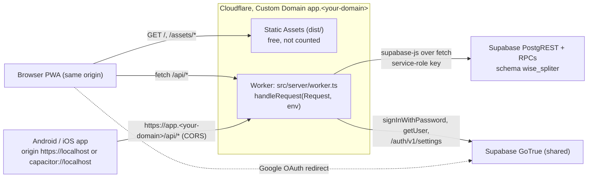

# Task: port the API to Cloudflare Workers (Free plan) with the PWA on Workers Static Assets

Status: plan only, nothing implemented. Cloudflare facts were fetched from developers.cloudflare.com on
2026-11-16 and are linked inline; the link targets are listed at the end. "Verified locally" means it was
run with wrangler 4.162.0 / workerd 1.20261113.1 against the local Supabase stack on 2026-11-16.

Placeholders: `<your-domain>` (production zone), `app.<your-domain>` (the hostname of the Worker),
`<project-ref>` (Supabase project), `<account-id>`. Never commit real values.

---

## 1. Goal, scope, topology

**Goal.** Serve the existing API (`src/server/`) and the Vite PWA (`dist/`) from one Cloudflare Worker on
one hostname, on the Workers Free plan, while the Bun server keeps working for local dev, Pyrite and Docker,
and the existing test suites keep passing.

**In scope:** a runtime-agnostic request core, a Bun adapter, a Workers adapter, `wrangler.toml`, secrets,
local verification, deploy, rollback, hardening, the mobile build and the request budget.

**Out of scope:** schema or RPC changes, Supabase plan changes, moving off Supabase, Realtime.

**What stays on Supabase (unchanged):** Postgres schema `wise_spliter` with all RPCs and FORCE RLS, GoTrue
(password and Google sign-in, email confirmation), PostgREST. The project is shared with merry-tools.



Requests to static assets are free and unlimited ([assets-billing], [pricing]). Only `/api/*` invokes the
Worker and counts toward the daily request limit.

---

## 2. Prerequisites

- A Cloudflare account on the Workers Free plan. Record which other Workers already run on it (they share
  the daily request pool, Section 11).
- The zone `<your-domain>` active on Cloudflare (any zone plan). The hostname `app.<your-domain>` must not
  have an existing CNAME record: "You cannot create a Custom Domain on a hostname with an existing CNAME DNS
  record" ([custom-domains]). Cloudflare creates the DNS record and certificate for the Custom Domain.
- Wrangler installed per project as a dev dependency ([install]): `bun add -d wrangler`. The Rate Limiting
  binding needs wrangler 4.36.0 or later ([ratelimit]); 4.162.0 was current on 2026-11-16.
- `npx wrangler login` (or `CLOUDFLARE_API_TOKEN` for CI), then `npx wrangler whoami`.
- Supabase production values at hand: URL (`https://<project-ref>.supabase.co`), the `sb_secret_...` key,
  the `sb_publishable_...` key. Migrations applied with `make migrate-remote` and checked with
  `make migrate-verify-prod`.
- Local stack for verification: `make setup-dev` (Supabase on 127.0.0.1:54321, seeded dev users).

---

## 3. Code changes (ordered)

### 3.0 Measured fit of the current code

Fact (verified locally): the unmodified server already runs on workerd through the documented
`httpServerHandler` from `cloudflare:node` ([node-http]), with `WISE_SPLITER_NO_AUTO_LISTEN=1`. Through
`wrangler dev`, `/api/health`, password login, pull (487 rows), push (validation path), the 256 KB 413 path
(declared, 2 MB, and chunked without `Content-Length`) and a `capacitor://localhost` preflight all returned the
same results as Bun. `process.env` was populated at module load (the import-time `requireEnv` calls passed),
matching the docs ([node-process], [flags]). Bundle: 866 KiB upload, 176 KiB gzip (limit 64 MiB [limits]);
`wrangler check startup` measured 35.8 ms active locally (limit 1 s [limits]).

So nothing hard-blocks the port. The refactor below is still the chosen path because: the node:http
emulation adds per-request stream conversion on a 10 ms CPU budget (not measured); `req.socket.remoteAddress`
is documented only for local runs ("will return `127.0.0.1` when ran locally" [node-http]); module-level env
reads go stale when a secret changes in a reused isolate ([bindings]); and `process.env.NODE_ENV` is a
build-time constant under wrangler ([bundling]). The shim remains a 0.5 day fallback (Section 12).

Everything Node/Bun-specific in `src/server/` (grep for `node:`, `process.`, `req.`, `res.`, `Buffer`,
module `let`/`Map`, `fs`, timers):

| file:line | What | Workers status | Action |
|---|---|---|---|
| index.ts:7, 96-106, 173, 332-333, 353-390 | `node:http` `IncomingMessage`/`ServerResponse` handler model, `res.writeHead/end`, `res.headersSent` | Works only through `httpServerHandler` ([node-http]) | Core returns `Response` (3.2) |
| index.ts:108-131 | Body read via `req.on('data'/'end'/'error')`, `req.pause()` | Node streams | Fetch `ReadableStream` reader with cap (3.2) |
| index.ts:99, 104 | `Connection: close`, `req.complete`, `req.destroy()` on 413 | Node socket control | Bun adapter only (3.3) |
| index.ts:397-407 | Top-level `await assertEmailConfirmationRequired()` (a `fetch`), `process.exit(1)`, `apiServer.listen` | "Workers do not allow I/O from outside a request context" ([bindings]) | Bun adapter only (3.3) |
| index.ts:50-51, 81-88 | Env read and asserted at import (`API_PORT`, `API_HOST`, `MAX_JSON_BODY_BYTES`, publishable key) | Works (process.env populated) but stale on rotation | Lazy getters via `readEnv` (3.1) |
| supabaseAdmin.ts:20-22 | `SUPABASE_URL`, `SUPABASE_SECRET_KEY`, `SUPABASE_SCHEMA` constants at import | Same | Getters (3.1) |
| supabaseAdmin.ts:39-44 | Module singleton `adminClient` | Survives secret change in a reused isolate ([bindings]) | Memo keyed on url, key, schema (3.1) |
| securityAndAuth.ts:205-207 | `MAX_BUCKETS` read at import; limiter `Map`s at module scope | Per isolate, so limits are per isolate, not global | Lazy `MAX_BUCKETS`; add Rate Limiting binding (3.5, 8) |
| securityAndAuth.ts:252 | `req.socket?.remoteAddress` fallback | No socket on Workers | Adapter passes the peer IP (3.2, 3.4) |
| securityAndAuth.ts:22, 49; index.ts:70, 398; supabaseAdmin.ts:212 | `process.env.NODE_ENV` | Statically replaced: `wrangler dev` = "development", `wrangler deploy` = "production" ([bundling]) | Read through `readEnv('NODE_ENV')` (3.1) |
| securityAndAuth.ts:26, 57, 235, 243, 332, 333; supabaseAdmin.ts:13 | Other `process.env` reads | Works, but brief requires Worker `env` | `readEnv` (3.1) |
| index.ts:58-75 | GoTrue autoconfirm cache, 10 min TTL, module scope, no timer | Compatible as is | Keep; drop only the startup call |
| securityAndAuth.ts:6 | `createHmac`, `timingSafeEqual` from `node:crypto` | Supported ([node-crypto]) | None |
| securityAndAuth.ts:70-71, 112-115; index.ts:160 | Global `Buffer`, base64url | Supported ([node-buffer]); `typeof Buffer` is `function` in workerd (verified) | None |
| securityAndAuth.ts:8 | `isIPv6` from `node:net` | Not listed on [node-net]; returned `true` for `2001:db8::1` in workerd (verified) | None; covered by a test |

No `fs`, `setTimeout` or `setInterval` exists in `src/server/`.

### 3.1 Runtime env accessor (supabaseAdmin.ts, securityAndAuth.ts, index.ts)

1. In `supabaseAdmin.ts`, next to `requireEnv`, add one accessor. Bun and the tests keep using
   `process.env` (tests mutate it at runtime); the Worker swaps in its `env` on every request:

   ```ts
   let runtimeEnv: Record<string, unknown> = process.env;
   export function setRuntimeEnv(env: Record<string, unknown>): void { runtimeEnv = env; }
   export function readEnv(name: string): string | undefined {
     const v = runtimeEnv[name];
     return typeof v === 'string' && v.trim() ? v.trim() : undefined;
   }
   ```
   `requireEnv` (line 12) calls `readEnv`. Non-string bindings (rate limiters) read as `undefined`.
2. Replace every `process.env` read listed in 3.0 with `readEnv(...)`, including all `NODE_ENV` reads, so
   the Worker's `NODE_ENV` comes from `vars`, not from the wrangler build constant.
3. `supabaseAdmin.ts:20-22`: turn the constants into `supabaseUrl()`, `supabaseSchema()` and read the
   secret key inside `createAdminClient`. Update users: index.ts:34-35, 60, 179, 232; supabaseAdmin.ts:33-35,
   84, 211; tests/unit/security-breach.test.ts:23 (read `process.env.SUPABASE_URL`/`SUPABASE_SCHEMA` as
   redteam-regression.test.ts:22-24 already does).
4. `supabaseAdmin.ts:39-44`: memoize the admin client on `` `${url}|${key}|${schema}` `` so a rotated key
   builds a new client. Warm `createClient` costs 0.09 ms p50 (Appendix B).
5. `index.ts:81-88`: `MAX_JSON_BODY_BYTES` becomes `maxJsonBodyBytes()`, the publishable key becomes
   `publishableKey()`. `API_PORT`/`API_HOST` stay in the Bun adapter (security-breach.test.ts:142 imports
   `API_HOST` from `index`).
6. `securityAndAuth.ts:205`: compute `MAX_BUCKETS` inside `hit()`.
7. Config assertions (`assertProductionSecretsConfigured`, `assertNumericEnv`, index.ts:50-51) run once per
   env object in `handleRequest` (remember the last env object; re-run when it changes).

### 3.2 Runtime-agnostic core: new `src/server/app.ts`

Move index.ts:53-351 (email-confirmation cache, `HttpError`, helpers, `routes`, `applyMutations`) into
`app.ts` and export:

```ts
export async function handleRequest(request: Request, env: Record<string, unknown>, peerIp?: string): Promise<Response>
```

1. **Request shape for the security helpers.** Add to `securityAndAuth.ts`
   `export interface ReqLike { method?: string; headers: Record<string, string | string[] | undefined>; socket?: { remoteAddress?: string } | null }`
   and change the `IncomingMessage` parameters at lines 158, 176, 242, 268, 274, 284, 290, 304, 310, 345 to
   `ReqLike`; delete the type import at line 7. `IncomingMessage` and the existing test fakes
   (security-breach.test.ts:363, redteam-regression.test.ts:1276, domain-and-portability.test.ts:444) already
   satisfy `ReqLike`, so those tests do not change. `app.ts` builds it once per request:
   `{ method: request.method, headers: Object.fromEntries(request.headers), socket: { remoteAddress: peerIp } }`
   (Fetch `Headers` iterate lower-case names, as Node does).
2. **Handlers** become `(ctx: { request: Request; url: URL; meta: ReqLike; origin?: string }) => Promise<Response>`.
   `sendJson` (index.ts:96-106) becomes `json(status, payload, origin, extra?)` returning
   `new Response(JSON.stringify(payload), { status, headers })` with `buildSecurityHeaders(origin)`; add
   `Set-Cookie` with `headers.append`. The 204 responses (index.ts:332, 358) return `new Response(null, { status: 204, headers })`.
3. **Body reading with the 256 KB cap** replaces index.ts:108-140, same messages and statuses:

   ```ts
   async function readJsonBody(req: Request, maxBytes = maxJsonBodyBytes()): Promise<Record<string, unknown>> {
     const tooLarge = () => new HttpError(413, `Payload too large: maximum request body is ${maxBytes} bytes`);
     const declared = Number(req.headers.get('content-length'));
     if (Number.isFinite(declared) && declared > maxBytes) throw tooLarge();
     const reader = req.body?.getReader();
     const chunks: Uint8Array[] = [];
     let total = 0;
     for (let r = await reader?.read(); r && !r.done; r = await reader!.read()) {
       total += r.value.byteLength;
       if (total > maxBytes) { await reader!.cancel(); throw tooLarge(); }
       chunks.push(r.value);
     }
     const bytes = new Uint8Array(total);
     let off = 0;
     for (const c of chunks) { bytes.set(c, off); off += c.byteLength; }
     const text = new TextDecoder().decode(bytes);
     // then the existing empty-body and JSON-object checks (index.ts:132-139)
   }
   ```
   Route caps stay: 16 KB for `/api/auth/*`, `maxJsonBodyBytes()` (default 262144) for push and receipts.
   Cloudflare's own body limit on a Free zone is 100 MB ([limits]), so the app cap is the binding one.
4. **Client IP.** Unchanged logic in `extractClientIp` (securityAndAuth.ts:242-253). With
   `TRUST_PROXY=cloudflare` it reads `cf-connecting-ip`; the fallback is the `peerIp` the adapter passed.
5. **Dispatch** keeps index.ts:355-372 order: `setRuntimeEnv(env)`, config assertion, OPTIONS preflight,
   CSRF/Origin check, `checkRateLimit`, route lookup, handler. The error mapping (index.ts:375-384) returns
   `Response`s; `res.headersSent` disappears.
6. **GoTrue autoconfirm check.** Keep `confirmationCheck` (index.ts:58) and
   `requireEmailConfirmationInProduction` (index.ts:69-75) as they are: module-scope cache with a 10 minute
   TTL, refreshed lazily inside a sign-in request, fail closed (503) on the password and Google routes. On
   Workers this costs one extra subrequest per isolate per 10 minutes; no timer is needed.
7. **Cookies and CORS.** `serializeSessionCookie` / `serializeClearSessionCookie` and
   `buildSecurityHeaders` are unchanged. The `__Host-ws_session` cookie (Secure, Path=/, no Domain,
   SameSite=Lax) works because the web app and API share `https://app.<your-domain>`. Native builds send
   `Authorization: Bearer` (sync-client.ts:445) and need CORS (Section 8).
8. `app.ts` must not import `node:http` at runtime (type-only imports are fine).

### 3.3 Bun adapter: `src/server/index.ts` (local dev, Pyrite, Docker, vitest)

Rewrite index.ts to a thin adapter that keeps its public exports (`handleApiRequest`, `apiServer`,
`API_HOST`, `API_PORT`, and re-exports `assertEmailConfirmationRequired`, `resetEmailConfirmationCacheForTests`):

1. `handleApiRequest(req, res)`: build a `Request` (`http://${req.headers.host ?? 'api.local'}${req.url}`,
   method, headers from `req.headers`, body `undefined` for GET/HEAD). For other methods wrap `req` in a
   `ReadableStream` whose `cancel()` calls `req.pause()` (not `destroy()`, which would kill the socket before
   the 413 is written), and pass `duplex: 'half'`:

   ```ts
   const body = new ReadableStream<Uint8Array>({
     start(c) { req.on('data', (d: Buffer) => c.enqueue(d)); req.on('end', () => c.close()); req.on('error', (e) => c.error(e)); },
     cancel() { req.pause(); },
   });
   ```
2. `const r = await handleRequest(request, process.env, req.socket.remoteAddress)`, then
   `res.writeHead(r.status, headers)` with `Set-Cookie` as an array (`r.headers.getSetCookie()`), and
   `res.end(Buffer.from(await r.arrayBuffer()))`. On 413 add `Connection: close` and, after `end`,
   `req.destroy()` if `!req.complete` (current behaviour, index.ts:99-105).
3. `apiServer = createServer(handleApiRequest)`; the startup block (index.ts:397-407: numeric and secret
   assertions, production autoconfirm check with `process.exit(1)`, `listen`) stays here, unchanged.

`Dockerfile.api`, `scripts/deploy-to-pyrite.sh`, `scripts/dev-stack.mjs` and `make api` need no change
(`COPY src/server` picks up the new files; the entry stays `src/server/index.ts`).

### 3.4 Workers adapter: new `src/server/worker.ts`

```ts
import { handleRequest } from './app';

export default {
  fetch(request: Request, env: Record<string, unknown>): Promise<Response> {
    if (env.TRUST_PROXY !== 'cloudflare' || typeof env.NODE_ENV !== 'string') {
      return Promise.resolve(new Response('{"ok":false,"error":"Server misconfigured"}', { status: 500 }));
    }
    return handleRequest(request, env, request.headers.get('cf-connecting-ip') ?? undefined);
  },
};
```

The guard fails closed if `NODE_ENV` is missing (otherwise the demo route would be on, securityAndAuth.ts:51-53)
or `TRUST_PROXY` is not `cloudflare` (otherwise every caller shares one limiter bucket). No
`cloudflare:workers` import is needed, so `tsc --noEmit` passes without Workers types.

### 3.5 Optional: Rate Limiting binding in `worker.ts`

The in-memory limiter is per isolate. Before `handleRequest`, call
`env.API_LIMITER.limit({ key: rateLimitKey(meta) })` (key reused from securityAndAuth.ts:268) and, for
`POST /api/auth/login`, `env.LOGIN_LIMITER.limit({ key: 'ip:' + ipBucket(ip) })`; on `success === false`
return the same 429 JSON with `Retry-After`. Limits: `period` must be 10 or 60 seconds, counts are
approximate and per Cloudflare location ([ratelimit]). The 900 s login window therefore stays in the
in-memory limiter; the binding adds a coarse cross-isolate cap. Free-plan availability: see Section 12.

### 3.6 Repo plumbing

- `package.json`: `wrangler` dev dependency.
- `.gitignore`: add `.wrangler/` and `.dev.vars*` (`.env.*` is already ignored).
- `wrangler.toml` at the repo root (Section 4).
- Follow-ups owned by other agents: `docs/architecture.md` (deployment topology), `.env.example` (Worker notes).

---

## 4. `wrangler.toml` template

Top level is production. `[env.dev]` exists only for `wrangler dev`; `vars`, `secrets` and bindings are
not inherited by environments, while `routes`, `assets` and `observability` are ([wrangler-config],
[wrangler-envs]).

```toml
name = "wise-spliter"
main = "src/server/worker.ts"
compatibility_date = "2026-11-15"
# Node.js compatibility is on by default for compatibility dates on or after 2026-08-04.
compatibility_flags = []
workers_dev = false
preview_urls = false
routes = [ { pattern = "app.<your-domain>", custom_domain = true } ]

[assets]
directory = "./dist"
not_found_handling = "single-page-application"
run_worker_first = [ "/api/*" ]

[observability]
enabled = true
head_sampling_rate = 1

[vars]
NODE_ENV = "production"
SESSION_AUDIENCE = "production"
TRUST_PROXY = "cloudflare"
SUPABASE_URL = "https://<project-ref>.supabase.co"
SUPABASE_SCHEMA = "wise_spliter"
VITE_SUPABASE_PUBLISHABLE_KEY = "<sb_publishable_...>"
ALLOWED_ORIGINS = "https://app.<your-domain>"

[secrets]
required = [ "SUPABASE_SECRET_KEY", "GRANT_TOKEN_SECRET" ]

[[ratelimits]]
name = "API_LIMITER"
namespace_id = "<unique-integer-1>"
  [ratelimits.simple]
  limit = 120
  period = 60

[[ratelimits]]
name = "LOGIN_LIMITER"
namespace_id = "<unique-integer-2>"
  [ratelimits.simple]
  limit = 10
  period = 60

[env.dev]
routes = []

[env.dev.vars]
NODE_ENV = "development"
SESSION_AUDIENCE = "development"
TRUST_PROXY = "cloudflare"
SUPABASE_URL = "http://127.0.0.1:54321"
SUPABASE_SCHEMA = "wise_spliter"
VITE_SUPABASE_PUBLISHABLE_KEY = ""
ALLOWED_ORIGINS = "http://localhost:4173,http://127.0.0.1:4173,http://localhost:8787,http://127.0.0.1:8787"
API_RATE_LIMIT = "120"

[env.dev.secrets]
required = [ "SUPABASE_SECRET_KEY", "GRANT_TOKEN_SECRET" ]

# Repeat the two [[ratelimits]] blocks as [[env.dev.ratelimits]] with different namespace_ids.
```

Why these settings:

- Custom Domain, because "If your Worker is your application's origin, use Custom Domains" ([routes]).
- `not_found_handling = "single-page-application"` serves `/index.html` for unmatched navigations
  ([spa]). With a compatibility date on or after 2025-04-01, navigation requests do not invoke the Worker
  ([spa]).
- `run_worker_first = ["/api/*"]` sends every `/api/*` request, including a browser navigation, to the
  Worker ([assets-binding]); without it a navigation to `/api/...` gets `index.html` ([spa]). Past the daily
  limit these requests "receive a 429 (Too Many Requests) response" ([assets-billing]), while assets keep
  being served.
- `workers_dev = false`, `preview_urls = false`: one public entry point. Zone WAF rules do not apply on
  `workers.dev`, which has its own non-configurable Browser Integrity Check ([workers-dev]).
- `secrets.required` makes `wrangler deploy` fail if a secret is missing ([wrangler-config]).
- `observability.enabled` persists Workers Logs; Free includes 200,000 log events per day, 3 days retention
  ([logs]).

---

## 5. Secrets and env mapping (from `.env.example`)

| `.env.example` key | Worker | Notes |
|---|---|---|
| `SUPABASE_SECRET_KEY` | **SECRET** | `sb_secret_...` from the Dashboard; bypasses RLS |
| `GRANT_TOKEN_SECRET` | **SECRET** | Generate fresh for production: `openssl rand -hex 32`. Never copy the dev value; at least 32 chars (securityAndAuth.ts:58) |
| `SUPABASE_URL` | var | `https://<project-ref>.supabase.co` |
| `SUPABASE_SCHEMA` | var | `wise_spliter` |
| `VITE_SUPABASE_PUBLISHABLE_KEY` | var | Read by the server for login and the settings check (index.ts:85-88); public by design |
| `VITE_SUPABASE_ANON_KEY` | omit | Legacy alias |
| `ALLOWED_ORIGINS` | var | `https://app.<your-domain>`; native origins are added by code (Section 8) |
| `TRUST_PROXY` | var | `cloudflare` (the Worker adapter refuses anything else) |
| `NODE_ENV` | var | `production`; required by the Worker adapter |
| `SESSION_AUDIENCE` | var | `production` |
| `RATE_LIMIT_WINDOW_SEC`, `API_RATE_LIMIT`, `AUTH_RATE_LIMIT_MAX`, `AUTH_RATE_LIMIT_WINDOW_SEC`, `RATE_LIMIT_MAX_KEYS`, `MAX_JSON_BODY_BYTES`, `SESSION_MAX_LIFETIME_DAYS` | optional vars | Defaults in securityAndAuth.ts:33-41 |
| `RATE_LIMIT_DISABLED` | never set | Disables both limiters |
| `DISABLE_NATIVE_ORIGINS` | never set | The mobile app needs the native origins |
| `API_HOST`, `API_PORT`, `WISE_SPLITER_NO_AUTO_LISTEN` | not used | Bun adapter only |
| `VITE_SUPABASE_URL`, `VITE_SUPABASE_SCHEMA`, `VITE_API_BASE_URL` | build time | Inlined into `dist/` by Vite, not Worker env |
| `SUPABASE_DIR`, `SUPABASE_DB_*`, `SUPABASE_DB_URL`, `DEV_USER_PASSWORD`, `APP_PORT`, `PLAYWRIGHT_*`, `IMAGE_REF` | not used | Tooling only |

Vars are plain text in `wrangler.toml` and not encrypted ([env-vars]); secrets are set with
`npx wrangler secret put <KEY>`, which "creates a new version of the Worker and deploys it immediately"
([secrets]). For the first deploy upload both secrets with the code via `wrangler deploy --secrets-file`
(JSON or `.env` format, [secrets]). Free plan: 64 variables per Worker, 5 KB each ([limits]).

---

## 6. Local verification

1. Stack: `make setup-dev` (local Supabase, migrations, dev users).
2. Gate first, in process (unchanged commands): `make typecheck && make test`. The suites drive the core
   through the Bun adapter (3.3), so they prove the refactor without Workers.
3. Build the PWA against local Supabase: `bunx vite build --mode development` (plain `vite build` uses mode
   `production` and would inline `.env.production` values).
4. Run the Worker in workerd:

   ```sh
   npx wrangler dev --env dev --env-file .env.development --port 8787 --var API_RATE_LIMIT:1000000
   ```
   Verified behaviour of this setup: values from `--env-file` override `vars` with the same name, and when
   `secrets.required` is set, keys in the file that are neither declared vars nor required secrets are
   dropped, so every key the API reads locally must be declared in `[env.dev.vars]`. `wrangler dev`
   sets `CF-Connecting-IP: 127.0.0.1` and passes a client-supplied value through, so per-IP tests can set
   the header. Workers code runs in a local `workerd` process ([local-dev]).
5. Smoke: `curl -s http://127.0.0.1:8787/api/health` (expects `"supabaseReachable":true`), then the
   Section 7 smoke script with `H=http://127.0.0.1:8787` and a dev user.
6. Existing suites over HTTP (needs a small test change, checklist item T6): add `API_TEST_BASE_URL` to the
   `beforeAll` of `tests/unit/security-breach.test.ts` (line 110) and `tests/unit/redteam-regression.test.ts`
   (line 626): when set, use it as `baseUrl` instead of starting the in-process server. Mark with
   `it.skipIf(REMOTE)` every test that mutates `process.env` and expects the server to see it, calls
   in-process limiter or token helpers, or replaces `globalThis.fetch` (redteam-regression.test.ts:710).
   Then: `API_TEST_BASE_URL=http://127.0.0.1:8787 make test`.
7. E2E through the Worker: `wrangler dev` as in step 4, `VITE_API_BASE_URL=http://127.0.0.1:8787 bun run dev:web`
   in a second shell, then `API_PORT=8787 bun run e2e`. Playwright reuses the running stack because its
   `webServer.url` is `http://localhost:${API_PORT}/api/health` with `reuseExistingServer: true`
   (playwright.config.ts:11-16).
8. CPU check before deploying: `npx wrangler deploy --dry-run --outdir /tmp/ws-worker` (size) and
   `npx wrangler check startup` ([wrangler-cmds]).

---

## 7. Deploy, smoke tests, rollback

**Deploy**

1. `.env.production`: set `VITE_API_BASE_URL=https://app.<your-domain>` (used by the web build and the APK).
2. `bun run build` (Vite production mode, `dist/`).
3. Secrets file for the first deploy, outside the repo, mode 600, without putting the key in shell history:
   `read -rs SB; (umask 077; printf 'SUPABASE_SECRET_KEY=%s\nGRANT_TOKEN_SECRET=%s\n' "$SB" "$(openssl rand -hex 32)" > /tmp/ws-secrets.env); unset SB`
4. `npx wrangler deploy --dry-run` then `npx wrangler deploy --secrets-file /tmp/ws-secrets.env`;
   `shred -u /tmp/ws-secrets.env`.
5. Later rotations: `npx wrangler secret put GRANT_TOKEN_SECRET` (rotating it signs everyone out).

**Smoke tests** (`H=https://app.<your-domain>`; a dedicated smoke account with a confirmed email, a
`wise_spliter` profile and no Google link; send a descriptive User-Agent):

```sh
A='wise-spliter-smoke/1.0'
curl -sS -A "$A" "$H/api/health"                                   # 200, "supabaseReachable":true
read -rs PW
TOKEN=$(curl -sS -A "$A" -H 'Content-Type: application/json' -H "Origin: $H" \
  -d "{\"email\":\"<smoke-email>\",\"password\":\"$PW\"}" "$H/api/auth/login" | jq -r .token)
curl -sS -A "$A" -H "Authorization: Bearer $TOKEN" "$H/api/ledger/pull?cursor=0&limit=1"   # 200, changes[]
curl -sS -A "$A" -H 'Content-Type: application/json' -H "Authorization: Bearer $TOKEN" \
  -d '{"mutations":[]}' "$H/api/ledger/push"                       # 200, {"results":[]} (no DB write)
curl -sS -o /dev/null -w '%{http_code}\n' -A "$A" -X OPTIONS -H 'Origin: capacitor://localhost' \
  -H 'Access-Control-Request-Method: POST' "$H/api/ledger/push"    # 204 (+ ACAO header with -i)
curl -sS -o /dev/null -w '%{http_code}\n' -A "$A" -X POST "$H/api/auth/demo"                 # 404
curl -sS -o /dev/null -w '%{http_code}\n' -A "$A" -X POST -H 'Origin: https://evil.example' "$H/api/auth/login"  # 403
curl -sS -o /dev/null -w '%{http_code}\n' -A "$A" "$H/some/deep/link"                       # 200 index.html
curl -sS -A "$A" -X POST -H "Authorization: Bearer $TOKEN" "$H/api/auth/logout"             # 200
npx wrangler tail                                                  # live logs ([tail])
```

Then open the PWA, sign in with Google once (needs `https://app.<your-domain>` in Supabase Auth Redirect
URLs, Section 8) and check the invocation logs for CPU time ([limits], [logs]).

**Rollback**

- `npx wrangler versions list`, then `npx wrangler rollback <VERSION_ID> --message "<reason>"`. Without an
  ID it rolls back to the version uploaded before the latest ([wrangler-cmds]). Only the 100 most recent
  versions are eligible; pages loaded before the rollback can request assets missing from the older version
  ([rollbacks]).
- Full exit from Workers: remove the Custom Domain and point `app.<your-domain>` at the Pyrite API with a
  proxied DNS record; that path then needs `TRUST_PROXY=cloudflare` and an origin lock on Pyrite
  (`.env.example` TRUST_PROXY notes). The APK keeps working because the hostname does not change.

---

## 8. Production hardening checklist

- [ ] **Supabase "Confirm email" ON** (`mailer_autoconfirm=false`). Without it sign-in returns 503
      (index.ts:69-75). The setting is project-wide, so it also applies to merry-tools.
- [ ] Supabase Auth Redirect URLs include `https://app.<your-domain>` (Google `redirectTo` is
      `window.location.origin`, supabase-sync.ts:482-489). Additive; does not affect merry-tools.
- [ ] **`TRUST_PROXY=cloudflare` plus origin lock.** On a Custom Domain the Worker is the origin
      ([custom-domains]); there is no separate server to firewall. Cloudflare sets `CF-Connecting-IP` to the
      client IP when the Worker makes no subrequest ([headers]). Keep `workers_dev` and `preview_urls` off.
      Do not enable the "Remove visitor IP headers" Managed Transform; Pseudo IPv4 "Overwrite Headers"
      replaces `CF-Connecting-IP` with a pseudo IPv4 ([headers]). If Pyrite stays up, it is a second entry
      point that bypasses the WAF: shut it down after the rollback window, or lock it to Cloudflare.
- [ ] **WAF rate-limit rule.** Free zones get 1 rule, path-only expressions, IP counting, a 10 s counting
      period and a 10 s mitigation timeout ([waf-rl]). Use it on path `/api/auth/login`, block above a
      chosen count per 10 s per IP.
- [ ] **Rate Limiting binding** (3.5) for a cross-isolate cap; approximate, per location ([ratelimit]).
- [ ] **Fail closed at the daily limit.** Use the Custom Domain (no origin to fall back to). `/api/*` is in
      `run_worker_first`, so past the limit it gets 429 while assets are still served ([assets-billing]).
      If a Worker route is ever used instead, set it to "Fail closed": "Fail open ... Bypasses the Worker"
      ([limits]). The client already treats any non-OK push or pull as `retry` and keeps the outbox
      (sync-client.ts:498-501, 554-557).
- [ ] **CORS.** `ALLOWED_ORIGINS=https://app.<your-domain>`. In production `getAllowedOrigins` drops
      `http://` entries and adds `capacitor://localhost` (iOS), `https://localhost` (Android, since
      capacitor.config `androidScheme: 'https'`), `ionic://localhost`, `tauri://localhost`,
      `https://tauri.localhost` (securityAndAuth.ts:321, 331-338). Preflights carry
      `Access-Control-Max-Age: 600`.
- [ ] **`SESSION_AUDIENCE=production`** and **`NODE_ENV=production`** as vars (token `aud`,
      securityAndAuth.ts:49; demo off, securityAndAuth.ts:51-53).
- [ ] `GRANT_TOKEN_SECRET` freshly generated, 32+ chars, differs from dev.
- [ ] `RATE_LIMIT_DISABLED` and `DISABLE_NATIVE_ORIGINS` unset.
- [ ] Observability on; alert by checking the dashboard for `exceededCpu` outcomes and Error 1102
      ([limits]).

---

## 9. Wiring the mobile app

1. `.env.production`: `VITE_API_BASE_URL=https://app.<your-domain>`.
2. `make apk-prod` (Makefile: sources `.env.production`, runs `APK_RELEASE=1 bash scripts/build-apk.sh`).
3. The guard (scripts/build-apk.sh:15-29) exits with code 2 unless the URL starts with `https://` and its
   host is not empty, `localhost`, `*.localhost`, `*.local`, `0.0.0.0`, `[::1]`, `127.*`, `10.*`,
   `192.168.*`, `172.16-31.*`, `169.254.*` or `host.docker.internal`.
4. At runtime `resolveApiUrl` prefixes `VITE_API_BASE_URL` in native shells and whenever the base is
   `https://` (supabase-sync.ts:19-37); in the web build that resolves to the same origin.
5. Note: the script runs `gradlew assembleDebug`, so `releases/wise-spliter.apk` is a debug build.

---

## 10. New Makefile targets (described, not implemented)

| Target | Does |
|---|---|
| `worker-dev` | `bunx vite build --mode development`, then `npx wrangler dev --env dev --env-file .env.development --port 8787` |
| `worker-test` | With `worker-dev` running: `API_TEST_BASE_URL=http://127.0.0.1:8787` plus the `make test` env loading |
| `worker-check` | `npx wrangler deploy --dry-run --outdir /tmp/ws-worker` and `npx wrangler check startup` |
| `worker-deploy` | Requires `.env.production`; `bun run build`, `npx wrangler deploy` (top level = production) |
| `worker-secrets` | `npx wrangler secret put SUPABASE_SECRET_KEY` and `GRANT_TOKEN_SECRET`, interactive |
| `worker-tail` | `npx wrangler tail` |
| `worker-rollback` | `npx wrangler rollback $(VERSION)`; without `VERSION` lists versions |

Add them to `.PHONY` and `help`.

---

## 11. Free-tier budget

Free plan limits ([limits], [pricing]): 100,000 requests per day per account, reset at midnight UTC; 10 ms
CPU per request; 128 MB memory per isolate; 50 subrequests per request; 6 simultaneous outgoing
connections; 100 Workers per account; static asset requests free.

Requests per DAU per day (docs/database-capacity.md 5.2, assumptions stated there): **7.5** for the web
build (same origin, no preflights), about **5.5** if the pull after a push is folded into the push
response, up to **14.8** for native builds (preflights).

DAU that fit, `share x 100,000 / requests per DAU`:

| This API's share of the account pool | Requests per day | Web DAU (7.5) | Native DAU, upper bound (14.8) |
|---:|---:|---:|---:|
| 100 % | 100,000 | 13,333 | 6,756 |
| 50 % | 50,000 | 6,666 | 3,378 |
| 25 % | 25,000 | 3,333 | 1,689 |

On Supabase Free, egress caps out at about 2,500 DAU and database size fills first over time
(database-capacity.md 5.2 and 6). At 2,500 DAU this API needs 18,750 (web) to 37,000 (native) requests per
day, so the Workers pool binds first only if this API's share of the pool is below about 19 % (web) or 37 %
(native).

Subrequests per request, counted from the code: push and pull 2 (profile lookup, RPC); login up to 6
(settings check at most once per 10 min, sign-in, up to 3 profile queries, `claim_members`); Google up to 6;
health 1. All under 50.

CPU (Appendix B): all request types measured well under 10 ms locally; the largest are a full push at the
client's 240 KB batch cap (sync-client.ts:455) and a 487-row pull, both about 2.6 to 2.7 ms p50 and 4.2 to
4.4 ms p95.

**Move to Workers Paid** ($5 per month minimum per account, 10 million requests per month included, then
$0.30 per million; 30 million CPU ms included; up to 5 min CPU per request [pricing], [limits]) when any of
these holds:
- the account's busiest day (all Workers together) passes 70,000 requests (a chosen 30 % safety margin,
  not a Cloudflare number);
- Workers Logs show `exceededCpu` outcomes or Error 1102;
- more than 200,000 log events per day are needed ([logs]).

---

## 12. Risks and open questions

Risks:

1. **10 ms CPU.** Estimates come from V8 in Node on a laptop, not Cloudflare hardware; supabase-js response
   handling and cold isolates add unmeasured work. Mitigation: read CPU time from invocation logs after
   deploy ([limits]); if needed lower `SYNC_PULL_MAX_LIMIT` (sync-contract.ts:43) or move to Paid.
2. **Shared pool.** Every Worker on the account draws from the same 100,000 per day ([limits]); a spike in
   another project (for example merry-tools) stops this API until midnight UTC.
3. **Per-isolate limiter.** In-memory limits apply per isolate; the binding is approximate and per
   location ([ratelimit]).
4. **Build-time `NODE_ENV`.** Any `process.env.NODE_ENV` left in server code is "development" under
   `wrangler dev` and "production" after `wrangler deploy`, whatever `vars` say ([bundling]; verified:
   `env.NODE_ENV` was "production" from vars while `process.env.NODE_ENV` was "development").
5. **Stale config in reused isolates** after a secret change ([bindings]); addressed by `readEnv` per
   request and the keyed client memo (3.1).
6. **Session continuity.** A fresh `GRANT_TOKEN_SECRET` invalidates sessions issued by any current
   production server; users sign in again once.
7. **Workers Logs pricing** moves to Cloudflare Observability pricing on 2026-12-01 ([logs]).
8. **Fallback shim.** If the refactor slips, `export default httpServerHandler(apiServer)` with
   `WISE_SPLITER_NO_AUTO_LISTEN=1` and `TRUST_PROXY=cloudflare` runs the current code (verified locally),
   but keeps risks 4 and 5 and the node:http emulation cost.

Open questions:

1. Is the Rate Limiting binding available on Workers Free? The binding page lists no plan restriction and
   the binding is GA ([ratelimit], [ratelimit-ga]); confirm on the first deploy.
2. Do requests blocked by a zone WAF rule count toward the 100,000 per day? Not stated on the pages read.
   Measure with the Worker request metrics after enabling the rule.
3. HTTP status of Error 1027 for Worker invocations outside `run_worker_first` is not stated on the pages
   read (the `run_worker_first` case is 429, [assets-billing]).
4. The fail open / fail closed toggle is documented for routes ([limits]); the pages read do not describe it
   for Custom Domains.
5. Is a Pyrite production deployment live now, and for how long should it stay as a rollback target?
6. Which Workers already share the Cloudflare account, and what is their daily volume?
7. What happens past 200,000 log events per day on Free is not stated on [logs].

---

## 13. Effort estimate and test-first checklist

Estimates (engineer hours, not measured):

| Step | Hours |
|---|---:|
| 3.1 env accessor, getters, keyed client memo | 2 to 3 |
| 3.2 `app.ts` core, body reader, `ReqLike` | 4 to 6 |
| 3.3 Bun adapter keeping test exports | 2 to 3 |
| 3.4 Worker adapter, `wrangler.toml`, `.gitignore`, wrangler dependency | 1 to 2 |
| 3.5 Rate Limiting binding (optional) | 1 to 2 |
| Tests (T1 to T7) | 3 to 5 |
| 6 Local verification incl. e2e | 2 to 3 |
| 2 + 7 Cloudflare setup, deploy, smoke, rollback drill | 2 to 3 |
| 8 Hardening (WAF rule, Supabase settings, CORS) | 1 to 2 |
| 9 Mobile build | 1 |
| 10 Makefile targets | 1 |
| **Total** | **20 to 31 (3 to 4 days)** |

Checklist (write each test first, watch it fail, then implement):

- [ ] T1 `readJsonBody(Request)`: a streamed body of 262,145 bytes without `Content-Length` returns
      HttpError 413; a declared `Content-Length` above the cap returns 413 without reading; 16 KB cap on
      `/api/auth/login`.
- [ ] T2 `readEnv`/`setRuntimeEnv`: switching env changes `supabaseUrl()`, `tokenAudience()`,
      `isDemoEnabled()`; changing `SUPABASE_SECRET_KEY` yields a new admin client.
- [ ] T3 `handleRequest` with `NODE_ENV=production`: `POST /api/auth/demo` is 404; with `development` it
      is not.
- [ ] T4 `extractClientIp` with `TRUST_PROXY=cloudflare` on a `ReqLike` built from a `Request` reads
      `cf-connecting-ip`; `ipBucket('2001:db8::1')` buckets the /64 (covers `node:net isIPv6`).
- [ ] T5 Worker adapter (`tests/unit/worker-adapter.test.ts`, calls `worker.fetch(new Request(...), env)`):
      `capacitor://localhost` preflight is 204 with ACAO; disallowed Origin POST is 403; missing `NODE_ENV`
      or `TRUST_PROXY !== 'cloudflare'` is 500; `GET /api/health` is 200 against local Supabase.
- [ ] Implement 3.1 to 3.4; `make typecheck && make test` green with the suites unchanged except
      security-breach.test.ts:23.
- [ ] T6 `API_TEST_BASE_URL` remote mode in both suites (Section 6, step 6); green against `wrangler dev`.
- [ ] T7 E2E against `wrangler dev` (Section 6, step 7).
- [ ] All five gates: `make typecheck && make migrate-verify && make test && make build && make e2e`.
- [ ] `wrangler deploy --dry-run` size and `wrangler check startup` recorded.
- [ ] Section 8 checklist done; first deploy; Section 7 smoke tests pass; CPU time read from logs.
- [ ] Rollback drill: `wrangler rollback` to the previous version and back.
- [ ] `make apk-prod` with the https URL; install and sync on a device.
- [ ] Follow-ups: `docs/architecture.md` deployment section, `.env.example` Worker notes, Makefile targets.

---

## Appendix A: verified locally (2026-11-16)

Unmodified `src/server/index.ts` behind `httpServerHandler(apiServer)`, `wrangler dev` with
`.env.development`, local Supabase:

| Check | Result |
|---|---|
| `GET /api/health` | 200, `supabaseReachable: true` |
| `POST /api/auth/login` (dev user) | 200, token, `Set-Cookie` present |
| `GET /api/ledger/pull?cursor=0&limit=500` | 200, 487 changes, 421,124 bytes |
| `POST /api/ledger/push` with an invalid mutation | 200, `status: "invalid"` |
| Push bodies of 300 KB, 2 MB, and 400 KB chunked | 413 each |
| Oversized push without token | 401 (auth runs before the body is read) |
| `OPTIONS` from `capacitor://localhost` | 204, ACAO set, `Access-Control-Max-Age: 600` |
| `Buffer`, `isIPv6`, process.env at import | available, `true`, populated |
| Bundle | 866.11 KiB, gzip 176.22 KiB |
| `wrangler check startup` | 35.8 ms active (local CPU) |

## Appendix B: CPU benchmark of the handler's JS work

V8 in Node 26.8.2 on an Intel i5-8265U. Code from `src/server/syncRows.ts` and `securityAndAuth.ts`,
bundled with esbuild; network and Postgres excluded. "first" is the first call in a fresh process
(includes JIT warm-up).

| Work | first | p50 | p95 |
|---|---:|---:|---:|
| `issueSessionToken` (HMAC sign) | 0.114 ms | 0.014 ms | 0.036 ms |
| `verifySessionToken` x2 (rate-limit key + auth) | 0.328 ms | 0.029 ms | 0.059 ms |
| `createClient` (login builds one per request), warm | | 0.090 ms | 0.193 ms |
| Push, 2 expenses: parse, validate, RPC body, response | 4.386 ms | 0.036 ms | 0.076 ms |
| Push, 200 expenses with 4 splits (286,415 B, above the 256 KB cap, so an upper bound) | 3.500 ms | 2.624 ms | 4.157 ms |
| Pull, 10 rows: parse, `fromDbRow`, stringify | 0.828 ms | 0.082 ms | 0.132 ms |
| Pull, 487 rows (427,886 B RPC payload) | 4.579 ms | 2.712 ms | 4.444 ms |

The first `createClient` in a fresh Node process took about 35 ms, but a CPU profile attributes it to
Node's lazy loading of `undici` and `zlib`; the `SupabaseClient` constructor itself was 0.9 ms. workerd has
native `fetch`, so that Node cost does not apply; the Worker's real cold cost is unmeasured (risk 1).

## Sources (fetched 2026-11-16)

- limits: https://developers.cloudflare.com/workers/platform/limits/
- pricing: https://developers.cloudflare.com/workers/platform/pricing/
- node-http: https://developers.cloudflare.com/workers/runtime-apis/nodejs/http/
- node-crypto: https://developers.cloudflare.com/workers/runtime-apis/nodejs/crypto/
- node-buffer: https://developers.cloudflare.com/workers/runtime-apis/nodejs/buffer/
- node-net: https://developers.cloudflare.com/workers/runtime-apis/nodejs/net/
- node-process: https://developers.cloudflare.com/workers/runtime-apis/nodejs/process/
- flags: https://developers.cloudflare.com/workers/configuration/compatibility-flags/
- bindings: https://developers.cloudflare.com/workers/runtime-apis/bindings/
- bundling: https://developers.cloudflare.com/workers/wrangler/bundling/
- secrets: https://developers.cloudflare.com/workers/configuration/secrets/
- env-vars: https://developers.cloudflare.com/workers/configuration/environment-variables/
- wrangler-config: https://developers.cloudflare.com/workers/wrangler/configuration/
- wrangler-envs: https://developers.cloudflare.com/workers/wrangler/environments/
- wrangler-cmds: https://developers.cloudflare.com/workers/wrangler/commands/workers/
- install: https://developers.cloudflare.com/workers/wrangler/install-and-update/
- local-dev: https://developers.cloudflare.com/workers/local-development/
- custom-domains: https://developers.cloudflare.com/workers/configuration/routing/custom-domains/
- routes: https://developers.cloudflare.com/workers/configuration/routing/routes/
- workers-dev: https://developers.cloudflare.com/workers/configuration/routing/workers-dev/
- spa: https://developers.cloudflare.com/workers/static-assets/routing/single-page-application/
- assets-binding: https://developers.cloudflare.com/workers/static-assets/binding/
- assets-billing: https://developers.cloudflare.com/workers/static-assets/billing-and-limitations/
- ratelimit: https://developers.cloudflare.com/workers/runtime-apis/bindings/rate-limit/
- ratelimit-ga: https://developers.cloudflare.com/changelog/post/2025-09-19-ratelimit-workers-ga/
- waf-rl: https://developers.cloudflare.com/waf/rate-limiting-rules/
- headers: https://developers.cloudflare.com/fundamentals/reference/http-headers/
- logs: https://developers.cloudflare.com/workers/observability/logs/workers-logs/
- tail: https://developers.cloudflare.com/workers/observability/logs/real-time-logs/
- rollbacks: https://developers.cloudflare.com/workers/versions-and-deployments/rollbacks/

[limits]: https://developers.cloudflare.com/workers/platform/limits/
[pricing]: https://developers.cloudflare.com/workers/platform/pricing/
[node-http]: https://developers.cloudflare.com/workers/runtime-apis/nodejs/http/
[node-crypto]: https://developers.cloudflare.com/workers/runtime-apis/nodejs/crypto/
[node-buffer]: https://developers.cloudflare.com/workers/runtime-apis/nodejs/buffer/
[node-net]: https://developers.cloudflare.com/workers/runtime-apis/nodejs/net/
[node-process]: https://developers.cloudflare.com/workers/runtime-apis/nodejs/process/
[flags]: https://developers.cloudflare.com/workers/configuration/compatibility-flags/
[bindings]: https://developers.cloudflare.com/workers/runtime-apis/bindings/
[bundling]: https://developers.cloudflare.com/workers/wrangler/bundling/
[secrets]: https://developers.cloudflare.com/workers/configuration/secrets/
[env-vars]: https://developers.cloudflare.com/workers/configuration/environment-variables/
[wrangler-config]: https://developers.cloudflare.com/workers/wrangler/configuration/
[wrangler-envs]: https://developers.cloudflare.com/workers/wrangler/environments/
[wrangler-cmds]: https://developers.cloudflare.com/workers/wrangler/commands/workers/
[install]: https://developers.cloudflare.com/workers/wrangler/install-and-update/
[local-dev]: https://developers.cloudflare.com/workers/local-development/
[custom-domains]: https://developers.cloudflare.com/workers/configuration/routing/custom-domains/
[routes]: https://developers.cloudflare.com/workers/configuration/routing/routes/
[workers-dev]: https://developers.cloudflare.com/workers/configuration/routing/workers-dev/
[spa]: https://developers.cloudflare.com/workers/static-assets/routing/single-page-application/
[assets-binding]: https://developers.cloudflare.com/workers/static-assets/binding/
[assets-billing]: https://developers.cloudflare.com/workers/static-assets/billing-and-limitations/
[ratelimit]: https://developers.cloudflare.com/workers/runtime-apis/bindings/rate-limit/
[ratelimit-ga]: https://developers.cloudflare.com/changelog/post/2025-09-19-ratelimit-workers-ga/
[waf-rl]: https://developers.cloudflare.com/waf/rate-limiting-rules/
[headers]: https://developers.cloudflare.com/fundamentals/reference/http-headers/
[logs]: https://developers.cloudflare.com/workers/observability/logs/workers-logs/
[tail]: https://developers.cloudflare.com/workers/observability/logs/real-time-logs/
[rollbacks]: https://developers.cloudflare.com/workers/versions-and-deployments/rollbacks/

Also used: https://developers.cloudflare.com/workers/databases/third-party-integrations/supabase/ (the
documented pattern is `@supabase/supabase-js` with `createClient(env.SUPABASE_URL, env.SUPABASE_KEY)` and
secrets set by `wrangler secret put`).
